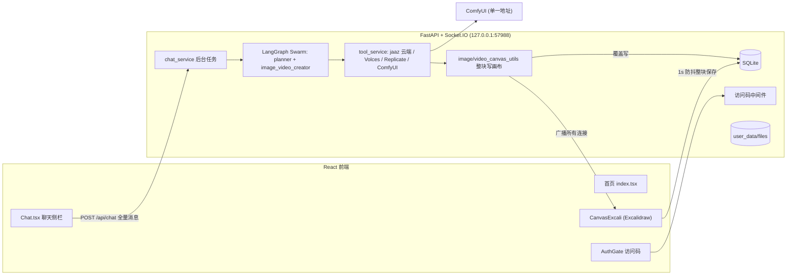
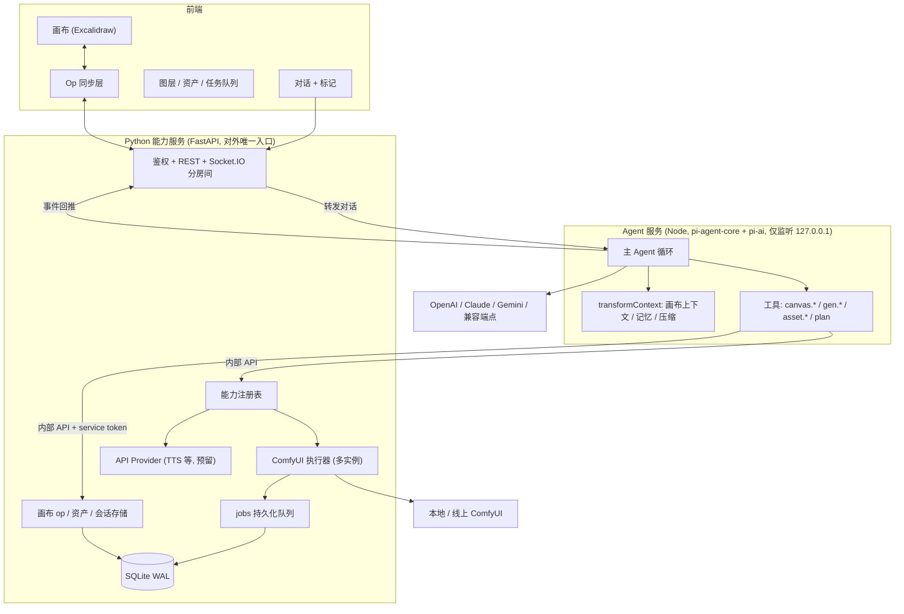

# Jaaz AIGC 无限画布：现状深度分析与发展规划

> 文档日期：2026-11-24（v4：补充详细技术设计 [06-Jaaz AIGC无限画布详细技术设计.md](./06-Jaaz%20AIGC无限画布详细技术设计.md) 与深挖代码缺陷）
> 实施状态：M0 加固（安全 P0、数据一致性、已知 bug 修复、鉴权补强）与 M1 画布快速改进（E1①/E1②/E2/E3/E4/E14）代码与自动单测已完成；M1 主体去云端/ComfyUI 能力层与 M2 pi Agent 待开展。
> 分析范围：当前工作区（含未提交的本地改动）的 `server/`、`react/src/`、`electron/`、`Docs/`、`todo.md`
> 目标定位：本地运行的 AIGC 无限画布，对标 Lovart、Flora、Krea Nodes、Figma Weave
> 配套文档：[00-文档索引.md](./00-文档索引.md)、[05-Jaaz Agent机制评估与pi改造方案.md](./05-Jaaz%20Agent机制评估与pi改造方案.md)、[06-Jaaz AIGC无限画布详细技术设计.md](./06-Jaaz%20AIGC无限画布详细技术设计.md)

## 0. 规划约束

| 约束 | 内容 |
| --- | --- |
| 运行形态 | 本地应用，单用户；可通过隧道远程访问，使用现有访问码鉴权 |
| 生成后端 | 图像、视频、音频生成全部通过本地或线上 ComfyUI 工作流实现 |
| 云端功能 | 移除全部 jaaz 云端功能（账号、云端模型工具、Magic、知识库、模板分享） |
| 扩展接口 | 保留 Provider 接口，后续可接 TTS、ASR、音乐等独立 API |
| 文本模型 | 开放配置，兼容 OpenAI、Claude、Gemini 三种原生协议，以及 OpenAI 兼容端点（DeepSeek、Qwen、Ollama、vLLM 等） |
| 协议 | 暂不处理 |

---

## 1. 目标定义

| 能力层 | 期望状态 | 当前 Jaaz |
| --- | --- | --- |
| 画布 | 承载图片、视频、音频、文本、形状、Frame、分组、图层，元素多时依然流畅 | Excalidraw 0.18.1，图片/视频可上画布，无音频元素、无图层面板、无 Frame 级生成 |
| 智能体 | 读懂画布（选区、标记、Frame、历史产物），规划多步任务，调用 ComfyUI 工作流，按布局写回画布，运行中可插话调整 | Planner + Creator 两个 LangGraph Agent，看不到画布，结果固定放到网格末尾 |
| 生成与编辑 | 文生图、图生图、局部重绘、擦除、扩图、抠图、超分、视频、TTS，全部映射到 ComfyUI 工作流 | ComfyUI 工作流可动态注册，类型固定为 image；其余工具依赖云端 |
| 资产与交付 | 素材库、版本历史、按 Frame 导出 | 导出 PNG/ZIP；无版本、无资产库 |

---

## 2. 现状概览

### 2.1 架构



### 2.2 模块完成度与处置

| 模块 | 关键文件 | 完成度 | 处置 |
| --- | --- | --- | --- |
| 画布渲染/保存 | [CanvasExcali.tsx](file:///c:/Users/patde/Documents/GitHub/jaaz/react/src/components/canvas/CanvasExcali.tsx) | 60% | 保留，改增量同步 |
| 聊天与任务进度 | [Chat.tsx](file:///c:/Users/patde/Documents/GitHub/jaaz/react/src/components/chat/Chat.tsx)、[chat_service.py](file:///c:/Users/patde/Documents/GitHub/jaaz/server/services/chat_service.py) | 65% | 保留，事件协议随 Agent 重构调整 |
| 智能体 | [agent_manager.py](file:///c:/Users/patde/Documents/GitHub/jaaz/server/services/langgraph_service/agent_manager.py) | 30% | 重构，见配套文档 |
| ComfyUI 工作流 | [comfy_dynamic.py](file:///c:/Users/patde/Documents/GitHub/jaaz/server/tools/comfy_dynamic.py)、[comfyui.py](file:///c:/Users/patde/Documents/GitHub/jaaz/server/tools/utils/comfyui.py) | 55% | 升级为能力层核心 |
| jaaz 云端工具（12 个） | `server/tools/generate_*_jaaz.py`、[jaaz_provider.py](file:///c:/Users/patde/Documents/GitHub/jaaz/server/tools/image_providers/jaaz_provider.py)、[jaaz_service.py](file:///c:/Users/patde/Documents/GitHub/jaaz/server/services/jaaz_service.py) | 不可用 | 删除 |
| Volces / Replicate / Wavespeed / OpenAI 直连图像工具 | `server/tools/*_volces.py`、`*_replicate.py`、`image_providers/` | 部分可用 | 下线默认注册；抽象出 Provider 接口规范后再决定是否保留 |
| Magic 生成 | [magic_service.py](file:///c:/Users/patde/Documents/GitHub/jaaz/server/services/magic_service.py)、`OpenAIAgents_service/` | 不可用 | 删除，改为"草图转图"ComfyUI 工作流（G8） |
| 知识库 | [knowledge.ts](file:///c:/Users/patde/Documents/GitHub/jaaz/react/src/api/knowledge.ts)、[Knowledge.tsx](file:///c:/Users/patde/Documents/GitHub/jaaz/react/src/components/knowledge/Knowledge.tsx) | 不可用 | 删除；后续以本地"项目记忆/设定集"替代（A7） |
| Agent Studio | [AgentStudio.tsx](file:///c:/Users/patde/Documents/GitHub/jaaz/react/src/components/agent_studio/AgentStudio.tsx) | 5% | 暂时隐藏入口，W1 阶段重做 |
| MCP | [mcp.py](file:///c:/Users/patde/Documents/GitHub/jaaz/server/services/mcp.py) | 0% | 删除，Agent 重构后按需接入 |
| 访问控制 | [auth_service.py](file:///c:/Users/patde/Documents/GitHub/jaaz/server/services/auth_service.py) | 70% | 保留，补强见第 4 节 |
| 测试 | `server/tests`、`react/test` | 15% | 每个阶段补回归测试 |

### 2.3 云端功能清理清单

| 位置 | 内容 |
| --- | --- |
| [config_service.py](file:///c:/Users/patde/Documents/GitHub/jaaz/server/services/config_service.py) | `DEFAULT_PROVIDERS_CONFIG['jaaz']`、`BASE_API_URL`、`_get_jaaz_url` |
| [tool_service.py#L57-L165](file:///c:/Users/patde/Documents/GitHub/jaaz/server/services/tool_service.py#L57-L165) | 12 个 `*_jaaz` 工具映射及对应文件 |
| [image_generation_core.py](file:///c:/Users/patde/Documents/GitHub/jaaz/server/tools/utils/image_generation_core.py) | `JaazImageProvider` 注册 |
| [image_vide_creator_config.py#L57](file:///c:/Users/patde/Documents/GitHub/jaaz/server/services/langgraph_service/configs/image_vide_creator_config.py#L57) | 提示词中写死的 `generate_image_by_gpt_image_1_jaaz` |
| [chat_router.py#L54-L90](file:///c:/Users/patde/Documents/GitHub/jaaz/server/routers/chat_router.py#L54-L90) | `/api/magic` 与取消接口 |
| [auth.ts](file:///c:/Users/patde/Documents/GitHub/jaaz/react/src/api/auth.ts) | 残留的 `authenticatedFetch` 与 `jaaz_access_token` |
| `react/src/constants.ts` | `BASE_API_URL` 及云端常量 |
| `react/src/components/chat/ChatMagicGenerator.tsx`、`canvas/pop-bar/CanvasMagicGenerator.tsx` | Magic 入口 |
| `react/src/routes/knowledge.tsx`、`agent_studio.tsx` | 路由入口 |
| `react/src/lib/communityModels.ts` | 云端模型过滤（清理完成后可删） |
| i18n 文案 | 云端、Magic、知识库相关键 |

---

## 3. 问题清单

分级：P0 = 安全或数据丢失；P1 = 功能错误或明显体验问题；P2 = 技术债。按本地应用定位，文件浏览类功能保留，路径穿越与任意删除仍按 P0 处理（隧道访问时可被远程触发）。

### 3.1 安全

| 级别 | 问题 | 位置 | 建议 |
| --- | --- | --- | --- |
| P0 | `delete_file` 直接 `os.remove(path)`，路径无限制 | [workspace.py#L51-L56](file:///c:/Users/patde/Documents/GitHub/jaaz/server/routers/workspace.py#L51-L56) | 限定在工作区根目录，`realpath` 校验前缀 |
| P0 | `update_file`/`read_file`/`rename_file`/`create_file` 可用 `..` 穿越 | [workspace.py#L16-L88](file:///c:/Users/patde/Documents/GitHub/jaaz/server/routers/workspace.py#L16-L88) | 统一 `safe_join()` + 单测 |
| P0 | `/api/file/{file_id}` 直接拼接文件名 | [image_router.py#L148-L154](file:///c:/Users/patde/Documents/GitHub/jaaz/server/routers/image_router.py#L148-L154) | 文件名正则校验 + realpath 检查 |
| P0 | `comfyui/proxy`、`comfyui/object_info` 接受任意 URL | [settings.py#L275-L298](file:///c:/Users/patde/Documents/GitHub/jaaz/server/routers/settings.py#L275-L298)、[image_router.py#L157-L179](file:///c:/Users/patde/Documents/GitHub/jaaz/server/routers/image_router.py#L157-L179) | 只允许已配置的 ComfyUI 实例 ID，不接受前端传 URL |
| P0 | `validateEmbeddable` 放行所有 URL | [CanvasExcali.tsx#L506-L510](file:///c:/Users/patde/Documents/GitHub/jaaz/react/src/components/canvas/CanvasExcali.tsx#L506-L510) | 只允许 `/api/file/` |
| P0 | `comfy_dynamic` 从工具参数直接拼接 `FILES_DIR` 未校验文件名 | [comfy_dynamic.py#L134-L152](file:///c:/Users/patde/Documents/GitHub/jaaz/server/tools/comfy_dynamic.py#L134-L152) | 传入穿越路径可读取本机图片并上传至线上 ComfyUI；改用 `safe_join()` |
| P1 | `GET /api/config` 明文返回全部 `api_key`，`get_settings` 注释称掩码但未实现 | [config_router.py#L14-L15](file:///c:/Users/patde/Documents/GitHub/jaaz/server/routers/config_router.py#L14-L15)、[settings_service.py#L79-L117](file:///c:/Users/patde/Documents/GitHub/jaaz/server/services/settings_service.py#L79-L117) | 返回前对密钥字段做掩码，保存时保留未改动的掩码占位 |
| P1 | 本机文件浏览可读全盘 | [workspace.py#L161-L425](file:///c:/Users/patde/Documents/GitHub/jaaz/server/routers/workspace.py#L161-L425) | 本地应用保留该功能，增加可配置的允许根目录（默认用户目录、ComfyUI output） |
| P1 | 上传接口不校验类型和像素 | [image_router.py#L20-L97](file:///c:/Users/patde/Documents/GitHub/jaaz/server/routers/image_router.py#L20-L97) | 字节上限、`MAX_IMAGE_PIXELS`、MIME 白名单 |
| P1 | Socket.IO `cors_allowed_origins="*"` | [websocket_state.py#L4-L7](file:///c:/Users/patde/Documents/GitHub/jaaz/server/services/websocket_state.py#L4-L7) | 限定前端源 |
| P1 | Electron 禁用 `webSecurity` 并允许不安全内容；安装进度用字符串拼接 `executeJavaScript` | [main.js#L138,171](file:///c:/Users/patde/Documents/GitHub/jaaz/electron/main.js#L138)、[ipcHandlers.js#L75-L107,277-294](file:///c:/Users/patde/Documents/GitHub/jaaz/electron/ipcHandlers.js#L75-L107) | 恢复 `webSecurity: true`；改用 `webContents.send` 传结构化消息，避免 Windows 反斜杠报错与脚本注入 |
| P1 | 自动更新仍指向上游 `origin`（`11cafe/jaaz`）且自动下载 | [package.json#L25-L32](file:///c:/Users/patde/Documents/GitHub/jaaz/package.json#L25-L32)、[main.js#L95-L100,356,403](file:///c:/Users/patde/Documents/GitHub/jaaz/electron/main.js#L95-L100) | 打包后可能静默覆盖本地定制版，移除上游 `autoUpdater` 逻辑 |
| P2 | PostHog 在设置环境变量时上报 | [main.tsx](file:///c:/Users/patde/Documents/GitHub/jaaz/react/src/main.tsx) | 本地应用建议移除 |

### 3.2 数据一致性

| 级别 | 问题 | 位置 | 建议 |
| --- | --- | --- | --- |
| P0 | 画布双写：后端生成后读-改-写整块 JSON，前端防抖也整块覆盖，生成期间编辑会丢元素 | [image_canvas_utils.py#L94-L148](file:///c:/Users/patde/Documents/GitHub/jaaz/server/tools/utils/image_canvas_utils.py#L94-L148)、[CanvasExcali.tsx#L83-L125](file:///c:/Users/patde/Documents/GitHub/jaaz/react/src/components/canvas/CanvasExcali.tsx#L83-L125) | 元素级 op（add/update/delete + version），详见 [06-Jaaz AIGC无限画布详细技术设计.md](./06-Jaaz%20AIGC无限画布详细技术设计.md#2-画布元素级增量同步协议根治双写竞争) |
| P0 | 图片和视频使用两把不同的锁 | [video_canvas_utils.py#L28-L44](file:///c:/Users/patde/Documents/GitHub/jaaz/server/tools/video_generation/video_canvas_utils.py#L28-L44) | 共用一个锁，最终改为增量写 |
| P0 | `comfy_dynamic` 写画布完全无锁 | [comfy_dynamic.py#L208-L270](file:///c:/Users/patde/Documents/GitHub/jaaz/server/tools/comfy_dynamic.py#L208-L270) | 并行工作流或与前端同时写会直接丢元素；纳入统一画布锁 |
| P0 | 聊天每次发送重新把图片转 base64 并随全量历史提交和写库 | [ChatTextarea.tsx#L188-L234](file:///c:/Users/patde/Documents/GitHub/jaaz/react/src/components/chat/ChatTextarea.tsx#L188-L234) | 多轮带图对话请求体和 SQLite 膨胀至数十 MB；改存 `asset_id` 引用 |
| P1 | 后端写画布时 `thumbnail` 被置空 | [db_service.py#L129-L138](file:///c:/Users/patde/Documents/GitHub/jaaz/server/services/db_service.py#L129-L138) | 不传时保留原值 |
| P1 | 缩略图和粘贴图片以 base64 存入画布 JSON | [CanvasExcali.tsx#L100-L107](file:///c:/Users/patde/Documents/GitHub/jaaz/react/src/components/canvas/CanvasExcali.tsx#L100-L107) | 粘贴即上传；服务端生成缩略图文件 |
| P1 | 删除画布不删会话、消息、文件 | [canvas.py#L44-L47](file:///c:/Users/patde/Documents/GitHub/jaaz/server/routers/canvas.py#L44-L47) | 事务内级联删除；文件进回收站 |
| P1 | 创建画布时聊天任务先于画布插入启动 | [canvas.py#L14-L22](file:///c:/Users/patde/Documents/GitHub/jaaz/server/routers/canvas.py#L14-L22) | 调换顺序 |
| P1 | 数据库多步写入无事务，外键未启用、未开 WAL | [db_service.py](file:///c:/Users/patde/Documents/GitHub/jaaz/server/services/db_service.py) | WAL + `foreign_keys=ON` + 事务 |
| P1 | 服务端信任客户端上送的完整历史 | [chat_service.py#L43-L73](file:///c:/Users/patde/Documents/GitHub/jaaz/server/services/chat_service.py#L43-L73) | 服务端读历史，客户端只发新消息 |
| P2 | 任务状态只存内存，重启丢失 | [stream_service.py](file:///c:/Users/patde/Documents/GitHub/jaaz/server/services/stream_service.py) | `jobs` 表持久化 |

### 3.3 后端功能错误

| 级别 | 问题 | 位置 |
| --- | --- | --- |
| P1 | `/api/list_chat_sessions` 缺参数必然 500 | [root_router.py#L133-L135](file:///c:/Users/patde/Documents/GitHub/jaaz/server/routers/root_router.py#L133-L135) |
| P1 | `list_tools` 中 `config[provider]` 可能 KeyError | [root_router.py#L105](file:///c:/Users/patde/Documents/GitHub/jaaz/server/routers/root_router.py#L105) |
| P1 | 工具返回值和上传接口硬编码 `http://localhost:{DEFAULT_PORT}`，隧道访问时链接失效 | [image_generation_core.py#L97](file:///c:/Users/patde/Documents/GitHub/jaaz/server/tools/utils/image_generation_core.py#L97)、[video_canvas_utils.py#L155](file:///c:/Users/patde/Documents/GitHub/jaaz/server/tools/video_generation/video_canvas_utils.py#L155)、[comfy_dynamic.py#L256](file:///c:/Users/patde/Documents/GitHub/jaaz/server/tools/comfy_dynamic.py#L256)、[image_router.py#L94](file:///c:/Users/patde/Documents/GitHub/jaaz/server/routers/image_router.py#L94) |
| P1 | Socket 事件广播给所有连接 | [websocket_service.py#L7-L26](file:///c:/Users/patde/Documents/GitHub/jaaz/server/services/websocket_service.py#L7-L26) |
| P1 | ComfyUI 工作流类型固定为 image | [tool_service.py#L280](file:///c:/Users/patde/Documents/GitHub/jaaz/server/services/tool_service.py#L280) |
| P1 | ComfyUI 客户端只支持单一地址，HTTP 与 WebSocket 都不带鉴权头；WebSocket 地址丢弃 base URL 的路径前缀，挂在反向代理子路径下的线上实例连不上 | [comfyui.py](file:///c:/Users/patde/Documents/GitHub/jaaz/server/tools/utils/comfyui.py)、[comfyui_execution.py#L145-L179](file:///c:/Users/patde/Documents/GitHub/jaaz/server/routers/comfyui_execution.py#L145-L179) |
| P1 | 取消聊天任务时不调用 ComfyUI `/interrupt`，GPU 上的任务继续跑完 | [chat_service.py#L104](file:///c:/Users/patde/Documents/GitHub/jaaz/server/services/chat_service.py#L104)、[comfyui_execution.py](file:///c:/Users/patde/Documents/GitHub/jaaz/server/routers/comfyui_execution.py) |
| P1 | `comfy_dynamic` 先注入参数后无条件覆写所有 `seed` 致无法复现，且未识别 Flux/Wan 的 `noise_seed` | [comfy_dynamic.py#L164-L191](file:///c:/Users/patde/Documents/GitHub/jaaz/server/tools/comfy_dynamic.py#L164-L191) |
| P1 | `comfyui_execution` 健壮性缺陷：服务未启动抛 `typer.Exit(code=1)`；`queue()`/`upload_image()` 漏调 `raise_for_status()`；`watch_execution()` 无超时且 WS 未在 `finally` 关闭；`on_status()` 被 `prompt_id` 过滤、`data['data']` `KeyError`、返回 `None` 三重失效；`get_node_title()` 不兼容动态子图节点 ID；输出提取忽略 `videos`/`audio` 且下游把非 image 全当 video | [comfyui_execution.py#L44,161,182,216,241,259,357,391](file:///c:/Users/patde/Documents/GitHub/jaaz/server/routers/comfyui_execution.py#L44)、[comfyui_history.py#L18](file:///c:/Users/patde/Documents/GitHub/jaaz/server/utils/comfyui_history.py#L18)、[comfy_dynamic.py#L232-L252](file:///c:/Users/patde/Documents/GitHub/jaaz/server/tools/comfy_dynamic.py#L232-L252) |
| P1 | 多处路由 `except Exception` 吞掉内部 `HTTPException(400/403/404)` 统一变成 500 | [tool_confirmation.py#L44](file:///c:/Users/patde/Documents/GitHub/jaaz/server/routers/tool_confirmation.py#L44)、[workspace.py#L157,240,287,315,389,423](file:///c:/Users/patde/Documents/GitHub/jaaz/server/routers/workspace.py#L157)、[settings.py#L296](file:///c:/Users/patde/Documents/GitHub/jaaz/server/routers/settings.py#L296) |
| P2 | 启动时工具未就绪即可接收请求 | [main.py#L41](file:///c:/Users/patde/Documents/GitHub/jaaz/server/main.py#L41) |
| P2 | ComfyUI 工作流只有新增与删除，缺少编辑/更新接口；`HttpClient` 设 `max_keepalive_connections=0` 禁用连接池 | [settings.py#L240-L273](file:///c:/Users/patde/Documents/GitHub/jaaz/server/routers/settings.py#L240-L273)、[http_client.py#L58](file:///c:/Users/patde/Documents/GitHub/jaaz/server/utils/http_client.py#L58) |
| P2 | 大量 `print` 日志；部分源码注释乱码 | 全局 |

### 3.4 前端问题

| 级别 | 问题 | 位置 | 建议 |
| --- | --- | --- | --- |
| P1 | 渲染函数体内调用 `excalidrawAPI.onChange(...)`，监听不断累积不注销 | [pop-bar/index.tsx#L24](file:///c:/Users/patde/Documents/GitHub/jaaz/react/src/components/canvas/pop-bar/index.tsx#L24)、[CanvasToolMenu.tsx#L16](file:///c:/Users/patde/Documents/GitHub/jaaz/react/src/components/canvas/menu/CanvasToolMenu.tsx#L16)、[CanvasViewMenu.tsx#L39](file:///c:/Users/patde/Documents/GitHub/jaaz/react/src/components/canvas/menu/CanvasViewMenu.tsx#L39) | 放入 `useEffect` 并调用返回的 unsubscribe；画布用久变卡的主要嫌疑 |
| P1 | 回调读取过期的 `messages`；`produce` 内调用 `setPending` | [Chat.tsx#L166-L211](file:///c:/Users/patde/Documents/GitHub/jaaz/react/src/components/chat/Chat.tsx#L166-L211) | 去重放进 reducer，副作用移出 |
| P1 | 事件订阅 `useEffect` 无依赖数组，每次渲染重绑 12 个事件 | [Chat.tsx#L483-L537](file:///c:/Users/patde/Documents/GitHub/jaaz/react/src/components/chat/Chat.tsx#L483-L537) | ref 保存最新回调，订阅一次 |
| P1 | 画布加载失败无错误界面 | [canvas.$id.tsx#L23-L96](file:///c:/Users/patde/Documents/GitHub/jaaz/react/src/routes/canvas.$id.tsx#L23-L96) | 错误页 + 重试 |
| P1 | 视频判断依赖 `link.includes('video')` | [CanvasExcali.tsx#L378-L385](file:///c:/Users/patde/Documents/GitHub/jaaz/react/src/components/canvas/CanvasExcali.tsx#L378-L385) | `customData.kind` 标记 |
| P1 | `SocketProvider` 开发模式写死 `http://localhost:57988` 且 `vite.config.ts` 未代理 `/socket.io`，并在 `async` 函数内返回清理函数致监听未解绑 | [socket.tsx#L44-L46,91-95](file:///c:/Users/patde/Documents/GitHub/jaaz/react/src/contexts/socket.tsx#L44-L46)、[vite.config.ts#L86-L98](file:///c:/Users/patde/Documents/GitHub/jaaz/react/vite.config.ts#L86-L98) | 统一走 `window.location.origin` + Vite 补 `/socket.io` WS 代理；清理函数放回 `useEffect` 顶层 |
| P1 | `CanvasExport` 用 `<canvas>.toDataURL()` 重编码破坏原始 PNG/ComfyUI 元数据，且无法导出带矢量标注/粗箭头/Frame 的合成图 | [CanvasExport.tsx#L14-L31](file:///c:/Users/patde/Documents/GitHub/jaaz/react/src/components/canvas/CanvasExport.tsx#L14-L31) | 拆分为"原始资产 Blob 导出"与"合成画布/Frame 导出"，见 [06-Jaaz AIGC无限画布详细技术设计.md](./06-Jaaz%20AIGC无限画布详细技术设计.md#44-导出能力重构e8x1) |
| P1 | `CanvasTextBackground` 改元素属性时未递增 `version`/`versionNonce`/`updated` | [CanvasTextBackground.tsx#L33-L38](file:///c:/Users/patde/Documents/GitHub/jaaz/react/src/components/canvas/pop-bar/CanvasTextBackground.tsx#L33-L38) | 统一经 `mutateSceneElements` 更新 |
| P2 | 系统提示词、模型选择存 localStorage | [configs.tsx](file:///c:/Users/patde/Documents/GitHub/jaaz/react/src/contexts/configs.tsx) | 迁移到后端设置 |
| P2 | `ModelSelectorV2/V3` 并存，`tldraw`、`openai` 前端依赖未使用 | [package.json](file:///c:/Users/patde/Documents/GitHub/jaaz/react/package.json) | 清理，减小包体 |
| P2 | Excalidraw 依赖 postinstall 补丁 | `react/scripts/patch-excalidraw-text-background.mjs` | 固定版本 + 回归测试 |
| P1 | 原生工具栏、顶部菜单、底部撤销/重做与缩放栏、右上角区域全部用 CSS 内部类名隐藏，自定义工具栏只补了 10 个工具 | [canvas.css#L1-L56](file:///c:/Users/patde/Documents/GitHub/jaaz/react/src/assets/style/canvas.css#L1-L56)、[CanvasToolMenu.tsx#L20-L32](file:///c:/Users/patde/Documents/GitHub/jaaz/react/src/components/canvas/menu/CanvasToolMenu.tsx#L20-L32) | 界面上没有撤销/重做按钮，素材库、Frame、橡皮擦、菱形、激光笔等不可用；Excalidraw 升级改类名后布局会错乱。见 7.4 |
| P1 | 箭头只有 1/2/4 三档线宽，箭头头部尺寸固定（arrow 为 25px，不随线宽变化），且 `getCanvasPadding` 对非 `freedraw`/`text` 元素写死 `20px` 离屏边距 | Excalidraw 0.18.1 `STROKE_WIDTH` 常量、`getArrowheadPoints` 与 `getCanvasPadding` | 做不出海报/标注常用的粗箭头，仅放大头部还会被 `20px` 离屏边距裁剪；需同步补丁 `getArrowheadPoints`、`getCanvasPadding` 与虚线比例。见 7.4 与 [06-Jaaz AIGC无限画布详细技术设计.md](./06-Jaaz%20AIGC无限画布详细技术设计.md#41-统一补丁机制reactscriptspatch-excalidrawmjs) |

### 3.5 工程化

| 级别 | 问题 | 建议 |
| --- | --- | --- |
| P1 | 后端依赖未锁版本，LangGraph 锁在 0.4.x | 锁文件；Agent 重构后移除 LangGraph 依赖 |
| P1 | 后端 `server/tests` 使用标准库 `unittest`（`server/.venv` 未装 `pytest`），前端在 Windows PowerShell 策略下需用 `npm.cmd run test:run`；CI 只构建不跑测试 | CI 增加 `unittest`、`vitest`、`tsc`、`ruff`（若切换 `pytest` 则统一补入锁文件） |
| P2 | `README_zh.md` 与 `README-zh.md` 重复 | 合并 |
| P2 | 无 API 与事件协议文档 | 补 `Docs/08-api.md`，事件用共享 schema |

---

## 4. 鉴权机制评估

### 4.1 现状

[auth_service.py](file:///c:/Users/patde/Documents/GitHub/jaaz/server/services/auth_service.py)、[routers/auth.py](file:///c:/Users/patde/Documents/GitHub/jaaz/server/routers/auth.py)、[main.py#L51-L61](file:///c:/Users/patde/Documents/GitHub/jaaz/server/main.py#L51-L61)、[websocket_router.py](file:///c:/Users/patde/Documents/GitHub/jaaz/server/routers/websocket_router.py)、[AuthGate.tsx](file:///c:/Users/patde/Documents/GitHub/jaaz/react/src/components/auth/AuthGate.tsx)

- `.env` 中的 `JAAZ_ACCESS_CODE`，未配置时拒绝启动
- 登录用 `hmac.compare_digest` 比较，签发 32 字节随机会话令牌
- Cookie：`HttpOnly`、`SameSite=Strict`、HTTPS 下 `Secure`，有效期 12 小时
- HTTP 中间件保护全部 `/api/*`（`/api/auth/*` 除外）；Socket.IO 连接时校验 Cookie
- 后端只监听 `127.0.0.1`

### 4.2 结论

单用户本地应用 + 隧道远程访问的场景下，这套机制方向正确，Cookie 属性设置得当，`SameSite=Strict` 也挡住了 CSRF。不需要做多用户体系。补齐下表 P1 项后可以长期使用。

| 级别 | 缺口 | 影响 | 建议 |
| --- | --- | --- | --- |
| P1 | 登录无失败次数限制 | 隧道公开后访问码可被持续尝试 | 按 IP（取 `X-Forwarded-For` 首段，仅在来自本机代理时信任）计数，5 次失败锁 15 分钟；全局每分钟上限 |
| P1 | 访问码强度不校验 | `.env` 里写 `123456` 也能启动 | 启动时要求至少 16 个字符，否则拒绝启动或强警告 |
| P1 | 会话只存内存 | 后端重启全部掉线；过期会话只在被访问时清理 | 改为无状态签名令牌：`HMAC(secret, expires)`，secret 由访问码与 `user_data` 中随机盐派生，更换访问码后旧会话自动失效；或会话落 SQLite |
| P1 | Socket 只在连接时校验 | 登出或过期后已建立的连接仍能收到生成事件 | 记录 `sid → token`，登出时断开对应连接，定时清理过期连接 |
| P1 | 前端未统一处理 401 | 会话过期后各页面接口报错，界面不回到登录页 | 封装统一 `apiFetch`，收到 401 时切回 AuthGate |
| P2 | 不能用"来自 127.0.0.1"判断本机免登录 | 隧道客户端转发到本机时来源同样是 127.0.0.1 | 本机免登录需求可以通过 Electron 启动时注入一次性令牌实现，不要按来源 IP 放行 |
| P2 | 无脚本/服务间调用凭据 | 后续 Agent 服务、ComfyUI 回调、命令行脚本无法调用 API | 增加 `JAAZ_SERVICE_TOKEN`（Bearer，仅接受 127.0.0.1 来源），供内部服务使用 |
| P2 | 文件 URL 需要 Cookie | 线上 LLM/ComfyUI 不能直接拉取 `/api/file/` | 给模型发图用 base64；给线上 ComfyUI 发图用其 `/upload/image` 接口上传；不要把文件目录设为公开 |
| P2 | 页面无安全响应头 | 隧道访问时可被 iframe 嵌入（点击劫持） | 增加 `X-Frame-Options: DENY`、基础 CSP |
| P2 | 残留 `authenticatedFetch` 读取 `jaaz_access_token` | 无实际作用 | 随云端清理删除 |

---

## 5. 智能体机制评估（摘要）

详细分析见 [05-Jaaz Agent机制评估与pi改造方案.md](./05-Jaaz%20Agent机制评估与pi改造方案.md)。

当前机制不够用，主要问题：

1. 只支持 `ChatOpenAI` 与 `ChatOllama`，Claude、Gemini 只能走兼容端点，丢失思考过程、原生图像输入等能力。
2. Swarm 的 planner → creator 交接多花一轮模型调用，规划内容对执行约束很弱。
3. Agent 看不到画布，也看不到自己生成的图片（工具结果只有文字和 localhost 链接），无法自检。
4. 运行中不能插话调整，只能整体取消；取消后 ComfyUI 队列里的任务继续执行。
5. 事件转换手写在 `StreamProcessor`，并行工具调用时参数流会串到错误的工具上。
6. 历史由前端上送，长会话无压缩。

采用 earendil-works/pi（`@earendil-works/pi-agent-core` + `@earendil-works/pi-ai`）新建 Node Agent 服务，Python 后端保留为能力服务（ComfyUI、文件、画布、数据库）。配套文档给出了对比、目标设计和分阶段迁移步骤。

---

## 6. 竞品对标

| 能力 | Lovart | Flora | Krea Nodes | Figma Weave | Jaaz 现状 |
| --- | --- | --- | --- | --- | --- |
| 交互范式 | 画布 + 对话 Agent | 节点画布 + Agent | 节点画布 + 实时生成 | 节点画布 + 可发布工具 | 画布 + 侧栏对话 |
| 画布感知 | 点选元素直接下指令 | 节点输入输出显式 | 节点显式 | 读取 Figma Frame | 仅附加图片 |
| 局部编辑 | Touch Edit 点选替换 | 节点组合 | 实时重绘 | 合成/调色节点 | 无 |
| 分层 | 拆分文字/主体/背景，导出 PSD | 无 | 无 | Compositor | 无 |
| 风格一致性 | Brand Kit | Style DNA | 风格参考 | 设计系统 | 无 |
| 批量 | 指令队列 | 表格驱动 Batch 节点 | 多分支 | 迭代器 | 提示词约定分批 |
| 视频 | 分镜 + 多视频模型 | 多视频模型 | 视频节点 | 时间线节点 | 少量云端视频工具 |
| 复用 | Create Skill | 模板工作流 | 工作流分享 | Weave Tools | ComfyUI 工作流注册 |

可借鉴的设计：

1. 指向式交互：画布上点选/框选生成标记，Agent 收到坐标、元素 ID 和裁剪图。
2. 局部编辑链：点选 → 分割出 mask → inpaint 工作流重绘。
3. 生成后可编辑：OCR 文字层 + 主体抠图 + 背景补全，拆成独立元素。
4. 对话与节点双视图：Agent 执行过程可展开为节点图，修改单个节点后重跑。
5. 技能复用：一次成功的流程保存为参数化技能。
6. 表格批量：CSV 每行一组变量，批量生成并排入 Frame。

ComfyUI 生态可以覆盖上面大部分生成能力：SAM/GroundingDINO 分割、Flux/Qwen-Image 编辑与 inpaint、扩图、RMBG 抠图、超分、Wan/Hunyuan 视频、IndexTTS/CosyVoice 等 TTS 节点。

---

## 7. Feature 规划

编号：C 画布、E 画布编辑器、A 智能体、G 生成编辑、K ComfyUI 能力层、M 资产、V 视频音频、W 工作流、X 交付、L 模型。优先级 S（必须）/ A（重要）/ B（增强）。

### 7.1 ComfyUI 能力层（K）

| 编号 | Feature | 优先级 | 说明 |
| --- | --- | --- | --- |
| K1 | 多实例管理 | S | 配置多个 ComfyUI 实例（本地/线上），每个实例：地址、鉴权头（Bearer/Basic/自定义 Header）、超时、并发上限、启用状态 |
| K2 | 健康检查与模型探测 | S | 定时请求 `/system_stats`、`/object_info`，显示在线状态、显存、可用模型；工作流缺模型或缺节点时提前提示 |
| K3 | 工作流注册表 | S | 每个工作流声明：能力类型（t2i、i2i、inpaint、outpaint、rembg、upscale、t2v、i2v、tts、music…）、输入映射（节点 ID.字段 → 参数名、类型、默认值、范围）、输出类型（image/video/audio）、目标实例 |
| K4 | 统一执行器 | S | 上传输入（`/upload/image`）→ 提交 `/prompt` → WebSocket 进度 → 下载 `/view` 输出 → 存入本地文件；线上实例走同一流程 |
| K5 | 取消与清理 | S | 取消任务时调用 `/interrupt` 并从 `/queue` 删除待执行项 |
| K6 | 调度 | A | 按能力与负载在多实例间分配；实例离线时切换到备用实例 |
| K7 | 工作流导入向导 | A | 导入 API 格式 JSON 后自动识别常见节点（CLIPTextEncode、LoadImage、KSampler seed、EmptyLatentImage 尺寸），生成输入映射草稿 |
| K8 | 内置工作流包 | A | 随应用附带常用工作流模板（文生图、编辑、inpaint、扩图、抠图、超分、图生视频、TTS），首次启动按已装模型提示可用项 |
| K9 | 线上平台适配位 | B | 为 RunningHub 等非标准 API 的线上 ComfyUI 平台预留适配器接口，按需实现 |

### 7.2 能力 Provider 接口（预留 API 扩展）

所有生成类能力走同一接口，ComfyUI 是默认实现，其他 API 作为可插拔实现：

```python
# 示意：能力 Provider 统一接口
class CapabilityProvider(Protocol):
    capability: Literal["t2i", "i2i", "inpaint", "upscale", "rembg",
                        "t2v", "i2v", "tts", "asr", "music"]
    async def run(self, params: dict, inputs: list[AssetRef],
                  progress: ProgressCallback, cancel: CancelToken) -> list[AssetRef]: ...
```

| 能力 | 默认实现 | 预留 API 实现 |
| --- | --- | --- |
| 图像生成/编辑 | ComfyUI 工作流 | OpenAI 图像、Gemini 图像等 |
| 视频 | ComfyUI 工作流（Wan、Hunyuan 等） | 可灵、Veo 等 |
| TTS | ComfyUI TTS 节点（IndexTTS、CosyVoice 等） | OpenAI TTS、Gemini TTS、ElevenLabs、火山 TTS |
| ASR | 预留 | Whisper 本地/API |
| 音乐 | 预留 | Suno 类 API、本地模型 |

Agent 侧只看到能力工具（如 `generate_image`、`edit_image`、`text_to_speech`），由注册表选择具体 Provider 与工作流。

### 7.3 画布核心（C）

| 编号 | Feature | 优先级 | 说明 |
| --- | --- | --- | --- |
| C1 | 元素级增量同步 | S | op（add/update/delete + version）替代整块覆盖 |
| C2 | 图片资源外置 | S | 粘贴/拖入自动上传，`dataURL` 改为 URL，缩略图服务端生成 |
| C3 | 智能放置 | S | 结果放在选中元素旁 → 目标 Frame 内 → 视口空白处 |
| C4 | 画布进度卡 | S | 生成前放占位卡，显示排队/进度/失败重试 |
| C5 | 音频元素 | S | TTS/音乐结果以音频卡片上画布：波形、播放、时长 |
| C6 | 视频元素原生化 | S | 自定义元素 + 封面帧 + 悬停播放，不走 iframe |
| C7 | 图层面板 | A | 元素列表、显隐、锁定、排序 |
| C8 | Frame/画板 | A | 预设尺寸，作为生成目标容器 |
| C9 | 元素来源与历史 | A | 记录 prompt、工作流、参数、父图，支持重新生成与回退 |
| C10 | 画布版本快照 | A | 定时与手动快照 |
| C11 | 大画布性能 | A | 按缩放加载缩略图/原图，视口外视频暂停 |

### 7.4 画布编辑器增强（E，Excalidraw）

Excalidraw 定位是手绘风白板，直接用于 AIGC 设计画布时，标注、海报排版、图片处理类能力不够。下面按"官方 API → 外层组件 → 补丁"的顺序选实现方式。

#### 7.4.1 功能清单

| 编号 | Feature | 优先级 | 说明 | 实现方式 |
| --- | --- | --- | --- | --- |
| E1 | 粗箭头 / 块箭头 | S | 两类：① 线条箭头加粗：线宽 6–32 可调，箭头头部随线宽等比放大；② 块箭头：实心填充的宽箭头形状（直箭头、双向、弯箭头、折线箭头、圆环箭头），可拉伸、可改填充色和描边 | ① 同步补丁 `getArrowheadPoints`、`getCanvasPadding`（防 20px 裁剪）与虚线比例；② 用闭合 `line` 多边形（`roundness: null`、`roughness: 0`）生成，`customData.kind = 'block-arrow'` 记录类型与参数，缩放时重算顶点；详见 [06-Jaaz AIGC无限画布详细技术设计.md](./06-Jaaz%20AIGC无限画布详细技术设计.md#41-统一补丁机制reactscriptspatch-excalidrawmjs) |
| E2 | 线宽与描边扩展 | S | 线宽除 1/2/4 外增加 6、8、12、16、24 及自定义输入；虚线间距可调 | 浮动条自定义控件，经 `mutateSceneElements` 递增 `version`/`versionNonce`/`updated` 写入任意 `strokeWidth`（同时修补虚线缩放）；详见 [06-Jaaz AIGC无限画布详细技术设计.md](./06-Jaaz%20AIGC无限画布详细技术设计.md#43-统一场景修改-helper-与坐标系封装) |
| E3 | 工具栏补全 | S | 增加菱形、Frame、橡皮擦、激光笔、嵌入、块箭头、标注组；工具多时分组折叠 | 扩展 [CanvasToolMenu.tsx](file:///c:/Users/patde/Documents/GitHub/jaaz/react/src/components/canvas/menu/CanvasToolMenu.tsx)，调用 `setActiveTool` |
| E4 | 撤销/重做、缩放、适配画布按钮 | S | 当前被 CSS 隐藏，只能用快捷键 | 自定义底部栏，调用 Excalidraw API 与历史动作 |
| E5 | 标注工具组 | S | 编号气泡（自动递增）、高亮框、圆圈圈选、标记点；标注可一键发送给 Agent 作为 A3 指向标记 | 组合元素 + `customData.mark`，与 Agent 标记共用数据结构 |
| E6 | 预设样式 | A | 一键套用"红色粗箭头 + 编号""黄色高亮框"等标注样式，以及海报标题、副标题文字样式；用户可保存自定义预设 | 预设 = 元素属性模板，存后端设置 |
| E7 | 文字增强 | A | 本地中文字体（思源黑体、思源宋体等）与用户字体注册；字号自由输入；文字描边、阴影；文字背景（已有补丁）纳入统一面板 | Excalidraw 字体列表固定，需补丁扩展字体注册；描边/阴影需补丁渲染与 SVG 导出 |
| E8 | 图片编辑交互 | A | 原生裁剪的入口按钮化；翻转、圆角、不透明度、描边；生成前后对比滑块；为局部重绘（G2）提供遮罩画笔图层 | 浮动条 + 外层 Canvas 遮罩图层；遮罩导出为 PNG 交给 ComfyUI |
| E9 | 右键菜单扩展 | A | 对图片：生成变体、抠图、超分、扩图、转视频、配音、查看生成参数；对文字：改写、翻译、配音 | Excalidraw 不开放右键菜单扩展，用 `onPointerDown`/`contextmenu` 事件弹出自有菜单 |
| E10 | 素材与形状库 | A | 原生库面板被隐藏；改为自有侧栏，合并资产库（M1）、形状库（箭头、标注、对话气泡、图标）| `addFiles` + `updateScene` 插入；形状库以 JSON 模板保存 |
| E11 | 对齐、吸附、网格 | B | 智能参考线、对象吸附、网格开关在工具栏可见 | `appState.objectsSnapModeEnabled`、`gridModeEnabled` |
| E12 | 小地图与导航 | B | 大画布缩略导航，点击跳转 | 外层组件读取元素边界绘制 |
| E13 | 快捷键面板 | B | 显示全部快捷键，解决自定义快捷键与原生冲突（如 `Ctrl+B`） | 自有面板 |
| E14 | 去掉 CSS 隐藏方式 | S | 能用 `UIOptions`（`canvasActions`、`tools`）关闭的改为配置关闭，必须隐藏的集中在一个样式文件并加截图回归 | 配置 + 回归测试 |
| E15 | 版本升级评估 | A | 当前 0.18.1；上游后续版本新增了便签、填充桶等功能（以 npm 发布说明为准）。升级前确认现有两个补丁的锚点是否仍匹配 | 升级分支 + 补丁测试 + 截图对比 |

#### 7.4.2 实现层级

| 层级 | 适用 | 约束 |
| --- | --- | --- |
| 1. 官方 API | 元素增删改、`customData`、`UIOptions`、`setActiveTool`、`onPointerDown`、`renderEmbeddable`、`validateEmbeddable` | 优先使用 |
| 2. 外层组件 | 浮动条、自定义工具栏、右键菜单、遮罩图层、小地图、进度卡 | 坐标换算统一封装（场景坐标 ↔ 视口坐标），沿用现有 pop-bar 模式 |
| 3. 补丁 | 箭头头部缩放、字体注册、文字描边/阴影、SVG 导出一致性 | 沿用 [patch-excalidraw-text-background.mjs](file:///c:/Users/patde/Documents/GitHub/jaaz/react/scripts/patch-excalidraw-text-background.mjs) 的锚点替换方式；每个补丁配单测，锚点找不到时让安装直接报错 |
| 4. Fork | 补丁超过 5 个或需要新增元素类型时 | 将 Excalidraw 以子模块引入并维护分支；M3 结束时复评 |

#### 7.4.3 自定义元素约定

Excalidraw 没有自定义元素类型，统一用 `customData.kind` 区分：

| kind | 底层元素 | 说明 |
| --- | --- | --- |
| `block-arrow` | 闭合 `line` | 参数：样式、头宽、尾宽、弯曲度 |
| `mark` | 组合（ellipse + text） | 编号、指向的元素 ID、给 Agent 的说明 |
| `video` | `embeddable` | 封面帧、时长、asset_id |
| `audio` | `embeddable` | 波形、时长、asset_id |
| `job` | `embeddable` | 生成进度卡，任务完成后替换为结果元素 |
| `generated` | `image` | 生成来源：prompt、工作流、参数、父元素 |

导出 PNG/SVG 时，`embeddable` 类元素需要用封面图替换后再导出。

### 7.5 智能体（A）

见配套文档第 6 节，要点：

| 编号 | Feature | 优先级 |
| --- | --- | --- |
| A1 | 画布上下文注入（选区、标记、Frame、视口） | S |
| A2 | 画布操作工具（列出、移动、分组、建 Frame、加文字、替换、删除） | S |
| A3 | 指向式标记指令 | S |
| A4 | 单主 Agent + 按需子 Agent，替换 Swarm | S |
| A5 | 生成结果回传给模型做视觉自检 | A |
| A6 | 批量与高耗时任务确认 | A |
| A7 | 画布级项目记忆/设定集（风格、角色、禁用元素） | A |
| A8 | 运行中插话（steering）与指令队列（follow-up） | A |
| A9 | 长会话压缩 | A |
| A10 | MCP 工具接入 | B |

### 7.6 生成与编辑（G，全部由 ComfyUI 工作流承载）

| 编号 | Feature | 优先级 |
| --- | --- | --- |
| G1 | 文生图 / 图生图 / 多图参考 | S |
| G2 | 局部重绘（画笔或框选 mask） | S |
| G3 | 选中图片浮动条：抠图、超分、扩图、擦除、变体、转视频、加入对话 | S |
| G4 | 点选编辑（分割 + 指令替换） | A |
| G5 | 图片文字修改 | A |
| G6 | 分层拆解，导出 PSD | B |
| G7 | 角色/产品参考库，生成时自动带入 | A |
| G8 | 草图转图（替代原 Magic） | A |
| G9 | 矢量化、3D | B |

### 7.7 资产（M）

| 编号 | Feature | 优先级 |
| --- | --- | --- |
| M1 | 资产库：来源、prompt、工作流、标签、所属画布；侧栏搜索与拖拽 | S |
| M2 | 生成历史时间线、收藏、重新生成 | A |
| M3 | 风格套件（色板、字体、Logo、语气），注入提示词 | A |
| M4 | 模板（Frame 布局 + 提示词骨架） | B |

### 7.8 视频与音频（V）

| 编号 | Feature | 优先级 |
| --- | --- | --- |
| V1 | 图生视频、首尾帧视频（ComfyUI） | A |
| V2 | 分镜板：脚本 → 分镜图 → 逐镜视频，按时间轴排入 Frame | A |
| V3 | TTS 配音：文本元素一键配音，生成音频元素 | A |
| V4 | 简单合成：片段拼接、配音、字幕，后端 ffmpeg | B |

### 7.9 工作流复用（W）与交付（X）

| 编号 | Feature | 优先级 |
| --- | --- | --- |
| W1 | 会话保存为技能（参数化提示词 + 工作流序列） | A |
| W2 | 表格批量生成，结果排入 Frame 网格 | A |
| W3 | Agent Studio 重做为可执行节点视图 | B |
| X1 | 按 Frame 导出 PNG/JPG/WebP/PDF，倍率、批量 | S |
| X2 | 画布打包导出/导入（JSON + 资源） | A |

### 7.10 文本模型（L）

| 编号 | Feature | 优先级 | 说明 |
| --- | --- | --- | --- |
| L1 | 三协议原生接入 | S | provider 类型：`openai`、`anthropic`、`google`、`openai-compatible`；每个配置 base URL、Key、模型列表 |
| L2 | 模型能力标记 | S | 视觉输入、工具调用、思考、上下文长度；Agent 按能力校验 |
| L3 | 角色模型 | A | 主 Agent、视觉自检、提示词改写可分别指定模型 |
| L4 | 连通性测试与用量统计 | A | 设置页一键测试；记录 token 与耗时 |

---

## 8. 目标架构



设计约束：

1. 浏览器只连接 Python 服务，鉴权、Socket、文件访问保持单一入口。
2. 画布写入只走 op 通道，前端编辑与 Agent 写入共用校验和版本号。
3. 生成任务持久化在 `jobs` 表，重启后可恢复或标记失败。
4. Agent 只按能力调用工具，不感知具体工作流和实例。

---

## 9. 路线图

| 阶段 | 主题 | 内容 | 完成标准 |
| --- | --- | --- | --- |
| M0 加固 | 安全、数据、鉴权 | 3.1 P0；统一画布锁（含 `comfy_dynamic`）、保留缩略图、先建画布；`comfyui_execution` 健壮性与 Key 掩码；路由不吞 `HTTPException`；`onChange` 泄漏与 `SocketProvider`/Vite 代理；Electron 安全与更新修复；第 4 节鉴权 P1（详见 [06-Jaaz AIGC无限画布详细技术设计.md](./06-Jaaz%20AIGC无限画布详细技术设计.md)） | 路径穿越/SSRF/404 用例通过；生成期间连续编辑 10 次无元素丢失；登录 5 次失败被锁；重启后会话保持；`GET /api/config` 不暴露明文 Key |
| M1 去云端 + ComfyUI 能力层 | 清理与能力层 | 2.3 清理清单；K1–K5 多实例、注册表、执行器、取消；能力 Provider 接口；L1–L2 三协议模型；画布快速改进 E1–E4、E14 | 不配置任何云端 Key，仅本地或线上 ComfyUI + 一个 LLM 完成文生图、图生图、图生视频、TTS；线上实例带鉴权头可用；可画出线宽 16 且头部等比放大的箭头和块箭头；界面有撤销/重做按钮 |
| M2 Agent 重构 | pi Agent 服务 | 配套文档阶段 1–3：Agent 服务骨架、功能对齐、引擎开关；A1–A3、A8 | `AGENT_ENGINE=pi` 下现有对话场景全部通过；运行中插话生效；取消后 ComfyUI 队列清空 |
| M3 画布能力 | 增量同步与编辑 | C1–C6、E5、E8–E10、G1–G3、M1、X1 | 生成结果出现在选区旁并带进度卡；选中图片 2 次点击内完成抠图/超分/扩图/重绘；音频元素可播放；编号标注可直接作为 Agent 指令上下文 |
| M4 专业化 | 自检、记忆、视频 | A5–A7、A9、C7–C10、E6、E7、E15、G4、G7、G8、V1–V3、K6–K8 | 一句话生成 6 张风格一致的套图并排入 Frame；分镜到视频与配音可走通 |
| M5 复用 | 技能与批量 | W1–W3、E11–E13、G5、G6、K9、A10、M3、M4 | 会话可保存为技能复用；表格批量生成可用 |


M1 与 M2 可部分并行：能力层的内部 API 定义好之后，Agent 服务可以基于它开发。

---

## 10. 待决策事项

| 编号 | 事项 | 选项 | 建议 |
| --- | --- | --- | --- |
| D1 | Agent 引擎 | Python 自研 / LangGraph 升级 / pi Agent 服务 | 已确认：earendil-works/pi，新增 Node Agent 服务 |
| D2 | 画布引擎 | 继续 Excalidraw / 迁移 tldraw | 继续 Excalidraw，按 7.4 增强；M3 结束时按补丁数量和自定义元素需求复评是否 Fork |
| D3 | Volces、Replicate 等直连工具 | 删除 / 改造为 Provider 实现保留 | M1 先下线默认注册，接口稳定后按需求改造 |
| D4 | 内置工作流包 | 随应用附带 / 用户自行导入 | 附带模板 JSON，不附带模型文件 |
| D5 | 会话免登录 | 保持访问码 / Electron 一次性令牌免登录 | Electron 模式免登录，浏览器与隧道访问保持访问码 |

---

## 附录 A：配套与建议补充的 Docs 文档

- 已创建：[00-文档索引.md](./00-文档索引.md)、[05-Jaaz Agent机制评估与pi改造方案.md](./05-Jaaz%20Agent机制评估与pi改造方案.md)、[06-Jaaz AIGC无限画布详细技术设计.md](./06-Jaaz%20AIGC无限画布详细技术设计.md)（SQLite 演进 DDL、op 同步协议、ComfyUI 能力层与 Provider、Excalidraw 增强方案、pi Agent 内部契约与鉴权安全设计）
- 待按阶段补充：`07-requirements.md`、`08-api.md`（REST、内部 API、Socket 事件）、`09-deployment.md`、`10-changelog.md`（完整清单见 [00-文档索引.md](./00-文档索引.md)）。

## 附录 B：参考资料

- Lovart：ChatCanvas、Touch Edit、Edit Elements、Brand Kit、PSD 导出、Create Skill（lovart.me、lovart.info 及公开评测）
- Flora、Krea Nodes、Figma Weave 对比（flora.ai、krea.ai、figma.com 及第三方评测）
- pi：https://github.com/earendil-works/pi（`@earendil-works/pi-agent-core`、`@earendil-works/pi-ai`、`@earendil-works/pi-mcp`）
- 本仓库调试记录：[01-Jaaz MOSS 文生图调试记录.md](./01-Jaaz%20MOSS%20文生图调试记录.md)、[02-Jaaz ImageEdit_MOSS 工作流调试记录.md](./02-Jaaz%20ImageEdit_MOSS%20工作流调试记录.md)、[03-Jaaz 聊天任务进度与结果恢复调试记录.md](./03-Jaaz%20聊天任务进度与结果恢复调试记录.md)
