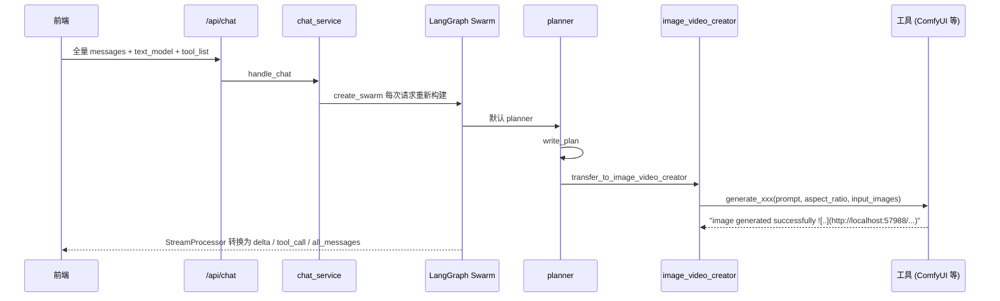
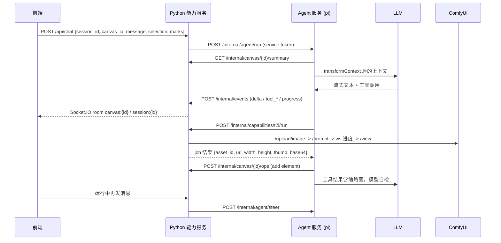

# Jaaz Agent 机制评估与 pi 改造方案

> 文档日期：2026-11-24
> 关联文档：[00-文档索引.md](./00-文档索引.md)、[04-Jaaz AIGC无限画布深度分析与规划.md](./04-Jaaz%20AIGC无限画布深度分析与规划.md)、[06-Jaaz AIGC无限画布详细技术设计.md](./06-Jaaz%20AIGC无限画布详细技术设计.md)
> 本文中的 pi 指 https://github.com/earendil-works/pi（原 badlogic/pi-mono），使用其中的 npm 包：
> - `@earendil-works/pi-agent-core`：Agent 循环、工具调用、状态与事件
> - `@earendil-works/pi-ai`：统一多供应商 LLM 接口（OpenAI、Anthropic、Google 及 OpenAI 兼容端点）
> - `@earendil-works/pi-mcp`：MCP 客户端，供 A10 接入外部工具
> - `@earendil-works/pi-telemetry`：遥测契约，可选，用于记录调用耗时与用量
>
> 已确认事项：采用 pi；接受新增 Node Agent 服务进程。实施时以仓库当前版本的 README 与类型定义为准，锁定具体版本号。

## 1. 结论

1. 当前 Agent 机制撑不起 AIGC 无限画布：模型接入窄、看不到画布、看不到自己的产出、不能运行中调整、取消不彻底、事件转换脆弱。
2. 不管选哪个方案，现有 LangGraph Swarm 结构都要拆掉重写，工具层也要随去云端一起重做。改造成本主要在工具与事件协议，换不换引擎差别没有想象中大。
3. 建议改造为 pi Agent 服务（Node/TypeScript），Python 后端保留为能力服务。pi 的事件流、steering/follow-up、`transformContext`、工具前置钩子正好对应本项目最缺的几项能力，`pi-ai` 原生覆盖 OpenAI、Claude、Gemini 和 OpenAI 兼容端点。
4. 主要代价是多一个 Node 进程和一层内部 API，以及 pi 版本变化较快带来的维护成本，用版本锁定和适配层控制。

---

## 2. 当前机制



关键代码：

- 模型创建：[agent_service.py#L138-L167](file:///c:/Users/patde/Documents/GitHub/jaaz/server/services/langgraph_service/agent_service.py#L138-L167)
- Agent 组装：[agent_manager.py#L18-L60](file:///c:/Users/patde/Documents/GitHub/jaaz/server/services/langgraph_service/agent_manager.py#L18-L60)
- 提示词：[planner_config.py](file:///c:/Users/patde/Documents/GitHub/jaaz/server/services/langgraph_service/configs/planner_config.py)、[image_vide_creator_config.py](file:///c:/Users/patde/Documents/GitHub/jaaz/server/services/langgraph_service/configs/image_vide_creator_config.py)
- 事件转换：[StreamProcessor.py](file:///c:/Users/patde/Documents/GitHub/jaaz/server/services/langgraph_service/StreamProcessor.py)
- 依赖版本：`langgraph==0.4.8`、`langgraph-swarm==0.0.11`、`langchain-openai==0.3.21`

---

## 3. 缺陷清单

| 编号 | 缺陷 | 位置 | 影响 |
| --- | --- | --- | --- |
| E1 | 模型只有 `ChatOpenAI` 和 `ChatOllama` 两种 | [agent_service.py#L149-L167](file:///c:/Users/patde/Documents/GitHub/jaaz/server/services/langgraph_service/agent_service.py#L149-L167) | Claude、Gemini 只能走兼容端点，丢失思考内容、原生图像输入、缓存等能力 |
| E2 | `temperature=0` 写死，`max_tokens` 被注释 | 同上 | 创意任务输出单调；长输出可能被截断 |
| E3 | planner → creator 交接 | [agent_manager.py#L40-L60](file:///c:/Users/patde/Documents/GitHub/jaaz/server/services/langgraph_service/agent_manager.py#L40-L60) | 每次多一轮模型调用；计划只是文字，对执行没有约束 |
| E4 | 每个请求重建 Agent 与 Swarm | [agent_service.py#L104-L120](file:///c:/Users/patde/Documents/GitHub/jaaz/server/services/langgraph_service/agent_service.py#L104-L120) | 启动开销；无法保持运行态 |
| E5 | Agent 看不到画布 | 上下文只有 `canvas_id`、`session_id`、`tool_list` | 无法理解"把左边那张改成…"类指令 |
| E6 | 工具结果只有文字和 localhost 链接 | [image_generation_core.py#L97](file:///c:/Users/patde/Documents/GitHub/jaaz/server/tools/utils/image_generation_core.py#L97) | 模型看不到生成的图，无法自检和迭代 |
| E7 | 并行工具调用的参数流归属错误 | [StreamProcessor.py#L144-L158](file:///c:/Users/patde/Documents/GitHub/jaaz/server/services/langgraph_service/StreamProcessor.py#L144-L158) | 只按"最后一个 id"归属，未使用 chunk 的 `index`，多个工具同时调用时参数串到别的工具卡片 |
| E8 | 需确认的工具名单写死且只有一个云端工具 | [StreamProcessor.py#L117-L125](file:///c:/Users/patde/Documents/GitHub/jaaz/server/services/langgraph_service/StreamProcessor.py#L117-L125) | 批量生成、视频等高耗时任务无确认 |
| E9 | 不能运行中插话 | 无 | 用户发现方向不对时只能取消重来 |
| E10 | 取消只 `task.cancel()` | [chat_router.py#L34-L52](file:///c:/Users/patde/Documents/GitHub/jaaz/server/routers/chat_router.py#L34-L52) | ComfyUI 队列不清理，GPU 继续执行 |
| E11 | 历史由前端上送，需要 `_fix_chat_history` 修补残缺工具调用 | [agent_service.py#L23-L75](file:///c:/Users/patde/Documents/GitHub/jaaz/server/services/langgraph_service/agent_service.py#L23-L75) | 历史可篡改；长会话无压缩，token 持续增长 |
| E12 | `done` 事件发两次 | [StreamProcessor.py#L40](file:///c:/Users/patde/Documents/GitHub/jaaz/server/services/langgraph_service/StreamProcessor.py#L40)、[chat_service.py#L117](file:///c:/Users/patde/Documents/GitHub/jaaz/server/services/chat_service.py#L117) | 前端状态抖动 |
| E13 | 提示词绑定具体工具名，批量规则写在提示词里 | [image_vide_creator_config.py#L48-L68](file:///c:/Users/patde/Documents/GitHub/jaaz/server/services/langgraph_service/configs/image_vide_creator_config.py#L48-L68) | 工具变化后提示词失效；"10 张一批"依赖模型自觉 |
| E14 | 无用量与耗时记录 | 无 | 无法评估模型成本和慢在哪里 |

---

## 4. 能力需求对照

| 需求 | 当前 | LangGraph 1.x 升级 | Python 自研循环 | pi-agent-core + pi-ai |
| --- | --- | --- | --- | --- |
| OpenAI / Claude / Gemini 原生 | 否 | 是（langchain-anthropic、langchain-google-genai） | 需自己写三套适配 | 是，内置并支持思考块、跨供应商切换 |
| 图片作为工具结果回传模型 | 否 | 可做，需自行处理各家格式 | 自己处理 | 工具结果支持图片内容 |
| 流式事件 | 手写转换，有 E7 问题 | 多种 stream mode，仍需转换 | 自定义 | 统一事件流：agent/turn/message/tool_execution 的 start/update/end |
| 运行中插话 | 否 | 需借助 interrupt/Command 组合实现 | 自己实现队列 | 内置 steering 与 follow-up 队列 |
| 上下文注入与压缩 | 否 | 中间件可做 | 自己实现 | `transformContext` 钩子，每次调用模型前改写上下文 |
| 工具前置校验/确认 | 写死名单 | HITL 中间件 | 自己实现 | `beforeToolCall` 钩子 |
| 并行工具执行 | ToolNode 并行 | 并行 | 自己实现 | 默认并行，结果按调用顺序回填，可按工具设为串行 |
| 取消 | 粗粒度 | 粗粒度 | 自定义 | `abort()`，工具收到中止信号 |
| 会话持久化 | 自己存 | checkpointer | 自己存 | 自己存（JSONL 或 SQLite），格式简单 |
| 子 Agent | Swarm 交接 | supervisor/subgraph | 自己实现 | 以工具形式创建子 Agent |
| 依赖体量 | 大 | 大 | 小 | 小 |
| 与前端类型共享 | 否 | 否 | 否 | TypeScript + TypeBox schema，可与前端共享事件和工具类型 |
| 技术栈变化 | 无 | 无 | 无 | 增加 Node 服务 |

---

## 5. 方案对比

| 方案 | 做法 | 优点 | 缺点 |
| --- | --- | --- | --- |
| A. LangGraph 1.x | 升级到 LangChain/LangGraph 1.x，单 Agent + 中间件 | 不换语言，可复用部分工具代码 | 抽象层厚，版本升级成本高；事件仍需二次转换；本项目用到的能力只占框架一小部分 |
| B. Python 自研轻量循环 | 参考 pi 设计，用官方 SDK（openai、anthropic、google-genai）写约 500 行循环 | 单一技术栈，完全可控 | 三家协议差异（工具 schema、图片格式、思考签名、流式格式）要自己维护，这部分正是 pi-ai 解决的问题 |
| C. pi Agent 服务（建议） | Node 服务运行 `pi-agent-core`，模型走 `pi-ai`；工具通过内部 API 调 Python 能力服务 | 能力匹配度最高；事件模型与前端 1:1；代码量小；TypeScript 与前端统一 | 多一个进程与内部 API；pi 版本迭代快；子 Agent、持久化需自己补 |

选 C 的理由：

1. 本项目 Agent 的核心难点是"画布上下文 + 运行中调整 + 多供应商"，pi 的 `transformContext`、steering、`pi-ai` 正好覆盖。
2. 去云端后工具集要整体重写（能力工具 + 画布工具 + ComfyUI），旧工具代码可复用的部分很少，换语言的边际成本低。
3. Electron 自带 Node 运行时，打包时可以用 `ELECTRON_RUN_AS_NODE` 启动 Agent 服务，不额外分发 Node。浏览器/隧道模式下用 `node` 直接启动。
4. 前端是 TypeScript，事件类型、工具参数 schema 可以放进共享包，减少前后端协议不一致。

方案 C 的约束：

- 锁定 pi 版本，Agent 服务内部封装一层 `AgentEngine` 接口，pi API 变化时只改适配层。
- Python 侧保持对外唯一入口，Agent 服务只监听 `127.0.0.1`，用 `JAAZ_SERVICE_TOKEN` 互相认证。

---

## 6. 目标设计

### 6.1 进程与调用关系



### 6.2 Agent 结构

单个主 Agent（画布导演），按需创建子 Agent，不再使用 Swarm 交接。

| 组件 | 内容 |
| --- | --- |
| 主 Agent | 理解需求、规划、调用工具、整理结果；系统提示词保持简短，规则放进工具描述和上下文 |
| 计划工具 `plan.update` | 维护可勾选的步骤列表，替代 planner Agent，前端显示进度 |
| 子 Agent 工具 `delegate` | 创建受限工具集的子 Agent，例如分镜编写、提示词改写、视觉质检；批量任务可并行 |
| `ask_user` 工具 | 需要用户选择时暂停并在前端展示选项 |

### 6.3 工具集

| 分组 | 工具 | 说明 |
| --- | --- | --- |
| 画布读取 | `canvas.summary`、`canvas.get_elements`、`canvas.snapshot` | 元素摘要、按 ID 取详情、指定区域截图 |
| 画布写入 | `canvas.add_asset`、`canvas.move`、`canvas.group`、`canvas.create_frame`、`canvas.add_text`、`canvas.replace_asset`、`canvas.delete` | 全部转为 op 写入，带版本号 |
| 生成 | `gen.image`、`gen.edit_image`、`gen.inpaint`、`gen.upscale`、`gen.remove_bg`、`gen.video`、`gen.tts` | 按能力调用 Python 能力注册表，参数为能力级（prompt、尺寸、参考图 asset_id、mask），不暴露工作流节点 |
| 资产 | `asset.search`、`asset.get` | 查找历史产物、参考图库 |
| 记忆 | `memory.read`、`memory.write` | 画布级设定集 |
| 能力发现 | `capabilities.list` | 返回当前在线实例支持的能力及参数范围 |

### 6.4 pi 核心 API 与钩子映射

详细内部接口与调度链路见 [06-Jaaz AIGC无限画布详细技术设计.md](./06-Jaaz%20AIGC无限画布详细技术设计.md#5-pi-agent-服务与内部-api-契约)。

| `pi-agent-core` 接口 | 用途与约束 |
| --- | --- |
| `new Agent({ initialState, ... })` + `replaceMessages()` | 从 SQLite `/internal/sessions/:id/messages` 加载历史后初始化实例；`initialState` 承载精简系统提示词、角色模型与工具集 |
| `prompt()` / `steer()` / `followUp()` / `abort()` | `steer()` 在当前工具回合结束后立即注入转向指令；`followUp()` 等当前轮彻底结束再触发；`abort()` 下发 `AbortSignal` 并级联取消 ComfyUI 队列 |
| `subscribe(listener)` | 监听 `agent_start` / `turn_start` / `message_update` / `tool_execution_*` / `agent_end`，1:1 映射为 Socket 事件 |
| `AgentTool.execute(params, signal, onUpdate)` | 能力工具订阅 Python SSE 进度并回调 `onUpdate`，保证并行调用进度精确对应各自 `toolCallId` |
| `transformContext` | 每次请求 LLM 前注入画布摘要、选区、标记、`memory_json` 与在线能力列表；将 2 轮外的 `ImageContent` 降级为 `asset_ref` 文字；超预算时触发摘要压缩 |
| `convertToLlm` | 过滤纯 UI 状态消息；核对模型 `input` 能力声明，仅对支持视觉的模型保留 `ImageContent` |
| `beforeToolCall` | 校验 `asset_id` 存在性；对批量（如 `quantity > 4`）或高耗时视频任务发送确认请求并在超时/拒绝时返回 `{ block: true, reason }` |
| `afterToolCall` | 记录耗时与状态；生成类工具附加 512px 缩略图 `ImageContent` 供视觉自检，单需求连续自检重绘上限默认 2 次防死循环 |

### 6.5 事件映射

| pi 事件 | Socket 事件 | 前端行为 |
| --- | --- | --- |
| `agent_start` | `task_started` | 显示运行中与计时 |
| `message_update`（文本增量） | `delta` | 追加文本 |
| `message_update`（思考增量） | `thinking_delta` | 折叠显示思考过程 |
| `tool_execution_start` | `tool_call` | 新建工具卡片 |
| `tool_execution_update` | `tool_progress` | ComfyUI 进度、排队位置 |
| `tool_execution_end` | `tool_call_result` | 更新卡片；生成类同时触发画布 op |
| `turn_end` | `turn_end` | 持久化本轮消息 |
| `agent_end` | `done` | 结束 pending，只发一次 |
| 错误 | `error` | 显示可读错误与重试 |

### 6.6 模型配置

```json
{
  "providers": [
    { "id": "openai", "type": "openai", "baseUrl": "https://api.openai.com/v1", "apiKey": "..." },
    { "id": "claude", "type": "anthropic", "apiKey": "..." },
    { "id": "gemini", "type": "google", "apiKey": "..." },
    { "id": "local", "type": "openai-compatible", "baseUrl": "http://127.0.0.1:11434/v1" }
  ],
  "roles": {
    "main": "claude/claude-sonnet-x",
    "vision_check": "gemini/gemini-flash-x",
    "prompt_rewrite": "local/qwen-x"
  }
}
```

模型名仅为示意，实际以用户配置为准。配置存 Python 侧设置，Agent 服务启动和变更时拉取；API Key 不下发到浏览器。

`pi-ai` 协议字段映射：
- OpenAI 官方与兼容端点：`api: "openai-responses"` 或 `"openai-completions"`，非标准端点（如本地 Ollama、vLLM、DeepSeek 代理）通过 `compat` 字段覆盖差异项；
- Anthropic Claude：`api: "anthropic-messages"`，保留思考块与多图输入；
- Google Gemini：`api: "google-generative-ai"`，保留思考块与原生多图能力；
- 多模态标记：`input: ["text", "image"]` 决定模型是否可接收 `ImageContent`（含画布缩略图与自检图）。

### 6.7 会话存储

- 服务端保存完整消息（含工具调用、工具结果、思考块），按 `session_id` 存 SQLite 表或 JSONL。
- 前端只发新消息、选区、标记；页面刷新从服务端拉取。
- 支持从某条消息分叉新会话（对应 pi 会话树思路），用于"回到这一步换个方向"。

---

## 7. 迁移步骤

| 阶段 | 内容 | 完成标准 |
| --- | --- | --- |
| 0. 内部 API | Python 新增 `/internal/*`：画布摘要与 op、能力列表与执行、事件回推、会话存取；`JAAZ_SERVICE_TOKEN` 认证 | 用 `unittest` 覆盖内部 API（若引入 `pytest` 再统一迁移）；外部访问 `/internal/*` 返回 403 |
| 1. 骨架 | 新建 `agent/` Node 包；接入 `@earendil-works/pi-agent-core` 与 `@earendil-works/pi-ai`；实现 `canvas.summary`、`gen.image`（ComfyUI 文生图）两个工具；Python 增加 `AGENT_ENGINE=langgraph|pi` 开关 | 开关切到 pi 后可完成一次文生图并上画布，事件在前端正常显示 |
| 2. 功能对齐 | 计划工具、图生图/编辑/视频/TTS 能力工具、取消（含 ComfyUI `/interrupt`）、任务状态恢复、确认流程 | 现有前端测试与手工用例在 pi 引擎下全部通过 |
| 3. 新能力 | steering 与 follow-up、画布上下文与标记、工具结果回传图片自检、子 Agent、上下文压缩 | 运行中插话可改变后续生成；"把选中三张排一行加标题"可执行 |
| 4. 下线旧引擎 | 删除 `langgraph_service/`、`StreamProcessor`、LangGraph/LangChain 依赖与旧工具文件 | `requirements.txt` 不再含 langgraph/langchain；全部测试通过 |

每个阶段结束都要能独立运行，阶段 1–3 期间旧引擎保留作为回退。

---

## 8. 风险

| 风险 | 应对 |
| --- | --- |
| pi API 变化 | 锁版本；`AgentEngine` 适配层；升级前跑回归 |
| 多进程打包与启动顺序 | Electron 主进程统一拉起 Python 与 Agent 服务，健康检查通过后再显示界面；浏览器模式提供一条启动脚本 |
| 内部 API 成为攻击面 | 只监听 127.0.0.1；service token；`/internal/*` 在外部中间件层直接拒绝 |
| 工具结果附带缩略图增加 token | 缩略图尺寸可配置；`transformContext` 只保留最近 N 张图片内容 |
| 部分 OpenAI 兼容端点工具调用不稳定 | 模型能力标记中记录"工具调用可靠性"，主 Agent 只允许使用标记为可靠的模型 |

---

## 9. 决策记录与待确认

| 事项 | 状态 |
| --- | --- |
| Agent 引擎采用 earendil-works/pi | 已确认（2026-11-24） |
| 新增 Node Agent 服务进程 | 已确认可接受 |
| 子 Agent 和视觉自检是否允许使用与主模型不同的模型 | 待确认，默认允许，按 6.6 角色模型配置 |
| Agent 服务目录与包管理 | 已确认：仓库根目录 `agent/`，与 `react/` 共享 `packages/shared`（事件与工具 schema） |
