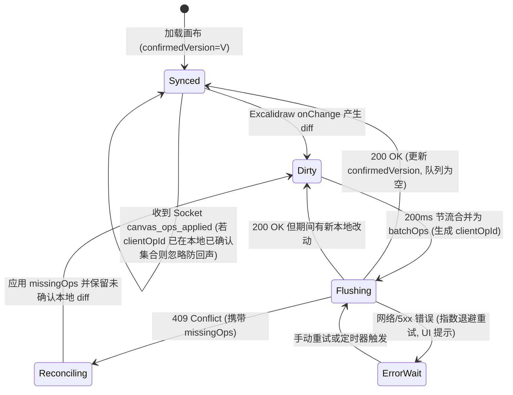
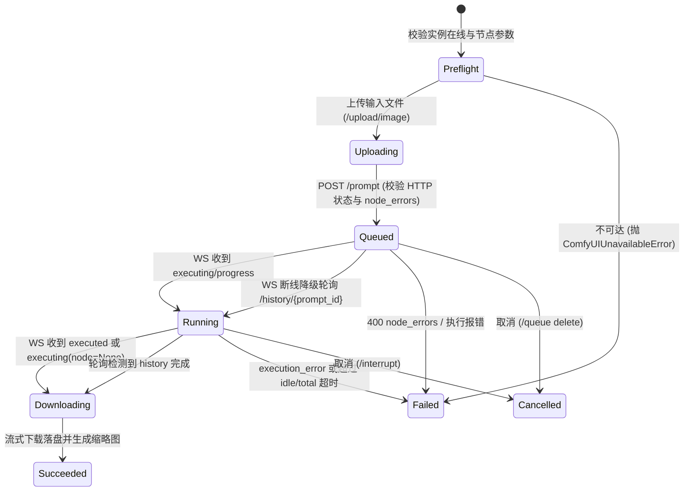

# Jaaz AIGC 无限画布：详细技术设计

> 文档日期：2026-11-24
> 实施状态：M0 安全/数据/鉴权基线与第 4 节画布快速改进（E1–E4、E14）已落地并通过单元测试；Schema v4–v6 演进、op 增量同步、ComfyUI 多实例能力层与 pi Agent 契约按后续 M1–M2 里程碑实施。
> 关联文档：[00-文档索引.md](./00-文档索引.md)、[04-Jaaz AIGC无限画布深度分析与规划.md](./04-Jaaz%20AIGC无限画布深度分析与规划.md)、[05-Jaaz Agent机制评估与pi改造方案.md](./05-Jaaz%20Agent机制评估与pi改造方案.md)
> 适用范围：M0（安全与数据加固）至 M5（工作流与交付）期间的架构落地方案、数据模型、接口契约与工程规范。

---

## 1. 存储模型与 SQLite Schema 演进（v4–v6）

### 1.1 连接配置与事务规范

当前 `DatabaseService`（[db_service.py](file:///c:/Users/patde/Documents/GitHub/jaaz/server/services/db_service.py)）每次调用新建连接、未开启 WAL 与外键检查，多步写操作缺少事务保护。演进后所有数据库连接必须执行初始化 PRAGMA：

```sql
PRAGMA journal_mode = WAL;
PRAGMA foreign_keys = ON;
PRAGMA busy_timeout = 5000;
PRAGMA synchronous = NORMAL;
```

工程约束：

1. 新增 `db_service.transaction()` 异步上下文管理器，统一执行 `BEGIN IMMEDIATE` / `COMMIT` / `ROLLBACK`，所有跨表或读改写操作必须在同一事务内完成。
2. 迁移执行前（`MigrationManager.migrate`），自动将 `localmanus.db`（含 `-wal`/`-shm` 若存在）复制到 `USER_DATA_DIR/backups/localmanus.db.bak-v{from_ver}-{timestamp}`，迁移失败时恢复备份并中止启动。

### 1.2 演进 Schema DDL

现有基线版本为 v3（`canvases`、`chat_sessions`、`chat_messages`、`comfy_workflows`）。以下分 v4（资产与任务持久化）、v5（画布增量同步与快照）、v6（ComfyUI 多实例与工作流扩展）递进：

```sql
-- ==========================================
-- v4: 统一资产、异步任务与消息树演进
-- ==========================================
CREATE TABLE IF NOT EXISTS assets (
    id TEXT PRIMARY KEY,                      -- 例如 as_xxxxxxxx
    kind TEXT NOT NULL CHECK (kind IN ('image', 'video', 'audio', 'mask')),
    filename TEXT NOT NULL UNIQUE,            -- FILES_DIR 下相对文件名
    thumb_filename TEXT DEFAULT '',           -- 512px WebP 缩略图或视频首帧文件名
    mime_type TEXT NOT NULL,
    bytes INTEGER NOT NULL DEFAULT 0,
    width INTEGER DEFAULT 0,
    height INTEGER DEFAULT 0,
    duration_ms INTEGER DEFAULT 0,            -- 视频/音频时长
    sha256 TEXT NOT NULL DEFAULT '',
    source TEXT NOT NULL CHECK (source IN ('upload', 'comfyui', 'api')),
    prompt TEXT DEFAULT '',
    workflow_id INTEGER,
    params_json TEXT DEFAULT '{}',
    parent_asset_id TEXT REFERENCES assets(id) ON DELETE SET NULL,
    canvas_id TEXT REFERENCES canvases(id) ON DELETE SET NULL,
    created_at TEXT DEFAULT (STRFTIME('%Y-%m-%dT%H:%M:%fZ', 'now')),
    deleted_at TEXT DEFAULT NULL              -- 非空表示进入回收站（软删除）
);
CREATE INDEX IF NOT EXISTS idx_assets_canvas_created ON assets(canvas_id, created_at DESC);
CREATE INDEX IF NOT EXISTS idx_assets_sha256 ON assets(sha256);

CREATE TABLE IF NOT EXISTS jobs (
    id TEXT PRIMARY KEY,                      -- job_xxxxxxxx
    session_id TEXT NOT NULL,
    canvas_id TEXT NOT NULL,
    tool_call_id TEXT NOT NULL DEFAULT '',
    capability TEXT NOT NULL,                 -- t2i/i2i/inpaint/upscale/rembg/t2v/i2v/tts/...
    provider TEXT NOT NULL DEFAULT 'comfyui',
    instance_id TEXT DEFAULT '',
    workflow_id INTEGER,
    remote_prompt_id TEXT DEFAULT '',         -- ComfyUI 返回的 prompt_id
    status TEXT NOT NULL CHECK (
        status IN ('queued', 'running', 'downloading', 'succeeded', 'failed', 'cancelled')
    ),
    progress_pct REAL NOT NULL DEFAULT 0,
    progress_text TEXT NOT NULL DEFAULT '',
    placeholder_element_id TEXT DEFAULT '',   -- 画布上的进度占位卡元素 ID
    result_asset_ids_json TEXT NOT NULL DEFAULT '[]',
    error TEXT DEFAULT '',
    created_at TEXT DEFAULT (STRFTIME('%Y-%m-%dT%H:%M:%fZ', 'now')),
    started_at TEXT DEFAULT NULL,
    finished_at TEXT DEFAULT NULL
);
CREATE INDEX IF NOT EXISTS idx_jobs_session_created ON jobs(session_id, created_at DESC);
CREATE INDEX IF NOT EXISTS idx_jobs_canvas_status ON jobs(canvas_id, status);

-- chat_messages 扩展：支持会话分叉树与消息格式版本
ALTER TABLE chat_messages ADD COLUMN parent_id INTEGER REFERENCES chat_messages(id) ON DELETE SET NULL;
ALTER TABLE chat_messages ADD COLUMN format_version INTEGER NOT NULL DEFAULT 1; -- 1=旧OpenAI结构, 2=pi AgentMessage
-- 约定：format_version=2 时严格禁止写入原始 base64 DataURL，图像统一存 {"type":"asset_ref","asset_id":"..."}

-- ==========================================
-- v5: 画布版本控制、增量操作日志与快照
-- ==========================================
ALTER TABLE canvases ADD COLUMN version INTEGER NOT NULL DEFAULT 1;
ALTER TABLE canvases ADD COLUMN thumbnail_asset_id TEXT DEFAULT '';
ALTER TABLE canvases ADD COLUMN memory_json TEXT NOT NULL DEFAULT '{}'; -- 画布级设定集（A7）

CREATE TABLE IF NOT EXISTS canvas_ops (
    seq INTEGER PRIMARY KEY AUTOINCREMENT,
    canvas_id TEXT NOT NULL REFERENCES canvases(id) ON DELETE CASCADE,
    base_version INTEGER NOT NULL,
    new_version INTEGER NOT NULL,
    client_op_id TEXT NOT NULL,
    actor TEXT NOT NULL CHECK (actor IN ('user', 'agent', 'system')),
    ops_json TEXT NOT NULL,                   -- CanvasOp[] JSON 数组
    created_at TEXT DEFAULT (STRFTIME('%Y-%m-%dT%H:%M:%fZ', 'now'))
);
CREATE UNIQUE INDEX IF NOT EXISTS idx_canvas_ops_version ON canvas_ops(canvas_id, new_version);
CREATE UNIQUE INDEX IF NOT EXISTS idx_canvas_ops_client_id ON canvas_ops(canvas_id, client_op_id);

CREATE TABLE IF NOT EXISTS canvas_snapshots (
    id TEXT PRIMARY KEY,
    canvas_id TEXT NOT NULL REFERENCES canvases(id) ON DELETE CASCADE,
    version INTEGER NOT NULL,
    label TEXT NOT NULL DEFAULT '',           -- 空为定时自动快照，非空为手动命名快照
    data_json TEXT NOT NULL,
    created_at TEXT DEFAULT (STRFTIME('%Y-%m-%dT%H:%M:%fZ', 'now'))
);
CREATE INDEX IF NOT EXISTS idx_canvas_snapshots_canvas_ver ON canvas_snapshots(canvas_id, version DESC);

-- ==========================================
-- v6: ComfyUI 多实例与工作流能力元数据
-- ==========================================
CREATE TABLE IF NOT EXISTS comfy_instances (
    id TEXT PRIMARY KEY,                      -- 例如 local_default / cloud_a100
    name TEXT NOT NULL,
    base_url TEXT NOT NULL,                   -- 允许带反向代理路径前缀，如 https://host/comfy
    auth_type TEXT NOT NULL DEFAULT 'none' CHECK (auth_type IN ('none', 'bearer', 'basic', 'header')),
    auth_header_name TEXT DEFAULT '',         -- auth_type='header' 时使用，如 X-API-Key
    auth_secret_ref TEXT DEFAULT '',          -- 密钥引用键（不直接存明文或下发前端）
    max_concurrency INTEGER NOT NULL DEFAULT 1,
    timeout_sec INTEGER NOT NULL DEFAULT 600,
    enabled INTEGER NOT NULL DEFAULT 1,
    priority INTEGER NOT NULL DEFAULT 100,    -- 数值越小优先级越高
    capabilities_json TEXT NOT NULL DEFAULT '[]',
    last_health_json TEXT NOT NULL DEFAULT '{}',
    updated_at TEXT DEFAULT (STRFTIME('%Y-%m-%dT%H:%M:%fZ', 'now'))
);

ALTER TABLE comfy_workflows ADD COLUMN capability TEXT NOT NULL DEFAULT 't2i';
ALTER TABLE comfy_workflows ADD COLUMN output_kind TEXT NOT NULL DEFAULT 'image'; -- image | video | audio
ALTER TABLE comfy_workflows ADD COLUMN instance_id TEXT DEFAULT '';               -- 空表示由调度器按能力自动路由
ALTER TABLE comfy_workflows ADD COLUMN seed_strategy TEXT NOT NULL DEFAULT 'random'; -- random | fixed | param
ALTER TABLE comfy_workflows ADD COLUMN schema_version INTEGER NOT NULL DEFAULT 1;
ALTER TABLE comfy_workflows ADD COLUMN enabled INTEGER NOT NULL DEFAULT 1;
```

同时补全工作流编辑端点：现有 `settings.py` 仅提供 `create_workflow`、`list_workflows`、`delete_workflow`，需新增 `PUT /api/settings/comfyui/workflow/{id}`，允许修改名称、能力标签、输入映射、输出类型、绑定实例与启用状态，并在保存后重新加载注册表。

### 1.3 懒迁移策略

历史数据无需停机全表扫描重写，在首次访问时惰性清洗：

1. **画布 JSON 清洗**：读取 `canvases.data` 或执行首次 op 写入时，扫描 `files` 字典。若发现 `dataURL` 以 `data:image/` 开头，解码落盘为独立文件并插入 `assets` 记录，将 `files[fileId].dataURL` 改写为 `/api/file/{filename}`；若 `canvases.thumbnail` 存有 base64，生成 256px WebP 文件后写入 `thumbnail_asset_id` 并清空原大字段。
2. **消息历史清洗**：读取 `format_version = 1` 的旧消息时，提取内容数组中的 `data:image/...` DataURL 落盘或按 sha256 复用已有 `assets` 记录，在内存中转换为 `asset_ref` 后再进入 Agent 上下文。

---

## 2. 画布元素级增量同步协议（根治双写竞争）

### 2.1 单事实源与 Op 契约

当前架构中，后端工具（`image_canvas_utils`、`video_canvas_utils`、`comfy_dynamic`）与前端 1 秒防抖保存均对 `canvases.data` 执行整块 JSON 覆盖写，导致并发生成与前端编辑互相覆盖。改造后：

1. **唯一写入口**：前端编辑、Agent 画布工具、ComfyUI 任务完成回填全部调用同一服务端方法 `CanvasOpService.apply_ops(canvas_id, base_version, client_op_id, actor, ops)`。
2. **单锁与事务**：对同一 `canvas_id` 在进程内使用统一 `asyncio.Lock` 排队，并在 SQLite `BEGIN IMMEDIATE` 事务中原子更新 `canvases.data`、`canvases.version` 与 `canvas_ops`。

TypeScript / JSON 契约（置于 `packages/shared`）：

```ts
export type CanvasOp =
  | { type: 'upsert_element'; element: OrderedExcalidrawElement }
  | { type: 'patch_element'; id: string; expectedVersion?: number; patch: Partial<OrderedExcalidrawElement> }
  | { type: 'delete_element'; id: string } // 软删除置 isDeleted: true，保留版本号
  | { type: 'upsert_file'; file: BinaryFileData }
  | { type: 'update_app_state'; patch: Pick<Partial<AppState>, 'viewBackgroundColor' | 'gridSize' | 'gridModeEnabled'> };

export interface ApplyOpsRequest {
  baseVersion: number;
  clientOpId: string;
  actor: 'user' | 'agent' | 'system';
  ops: CanvasOp[];
}
```

持久化字段过滤：`update_app_state` 只允许同步背景色、网格尺寸等持久化画布属性；`selectedElementIds`、`scrollX`、`scrollY`、`zoom`、`activeTool` 等视口交互态只保留在客户端内存中，不触发后端保存，避免切换选择或拖动画布产生无效写库。

### 2.2 冲突合并规则

单用户工作模式下，冲突主要来自“用户前端持续拖拽/标注”与“后台 Agent/ComfyUI 生成回填”重叠：

1. **幂等去重**：检查 `(canvas_id, client_op_id)` 是否已存在于 `canvas_ops`；命中时直接返回当时产生的 `new_version`，防止网络重试重复写入。
2. **无冲突快进**：若 `baseVersion === currentVersion`，或客户端改动的 `element.id` 集合与 `baseVersion..currentVersion` 期间服务端已应用 ops 改动的 `element.id` 集合**无交集**，则直接应用到最新场景，递增 `new_version = currentVersion + 1`，返回 `{ newVersion, missingOps }`，并向 Socket 房间 `canvas:{canvasId}` 广播增量事件 `canvas_ops_applied`。
3. **同元素冲突**：若 `baseVersion < currentVersion` 且请求改动的某个 `element.id` 在期间已被修改：
   - 对比元素级 `element.version`：若传入版本号严格高于服务端当前元素的 `version`（且请求来自用户显式强制覆盖），可合入；
   - 否则返回 HTTP `409 Conflict`，响应体携带 `currentVersion` 与 `(baseVersion..currentVersion]` 区间的 `missingOps`。前端收到 409 后，利用 Excalidraw 的 `reconcileElements`（或按 `element.version` / `versionNonce` 取高版本）与本地最新场景合并，丢弃过期操作或基于 `currentVersion` 重新打包 `pendingLocalOps` 重试一次。

### 2.3 前端同步状态机



防回声关键规则：前端通过 `excalidrawAPI.updateScene({ elements, captureUpdate: CaptureUpdateAction.NEVER })` 应用来自服务端或 Agent 的远程 ops，并用 `isApplyingRemoteOpsRef` 标记，避免触发 `onChange` 再次生成本地 ops 回传给后端。

### 2.4 生成占位卡生命周期

1. **入队前占位**：工具调用提交至 ComfyUI 之前，Agent/能力层先计算出智能放置坐标 `(x, y, w, h)`，通过 `apply_ops` 写入一个 `embeddable` 元素，设置 `customData: { kind: 'job', jobId, capability, promptPreview, aspectRatio, status: 'queued' }`。
2. **执行中进度**：ComfyUI WebSocket 推送排队位置、当前节点和采样百分比。服务端**只写内存广播到 Socket 房间**，前端占位卡组件直接渲染进度条、节点名称与“取消”按钮，不往 SQLite 写入高频进度，避免写放大。
3. **完成替换**：结果落盘并注册 `assets` 后，后端在单一事务内提交原子 ops：`upsert_file`（新资产 URL）+ `upsert_element`（替换同 `id` 或删除占位卡并在原坐标 `(x, y)` 插入真实图片/视频/音频元素，保留 `customData.kind = 'generated'` 溯源信息）。
4. **失败或取消**：通过 `apply_ops` 更新占位卡 `customData.status = 'failed' | 'cancelled'` 与 `error`，画布上显示错误卡片与“重试 / 删除”操作按钮。

---

## 3. ComfyUI 多实例能力层与可插拔 Provider 设计

### 3.1 URL 规范化、连接池与鉴权头

修复现有 `comfyui_execution.py` 丢失路径前缀与无鉴权的问题，同时修复 `http_client.py#L58` 设置 `max_keepalive_connections=0` 禁用连接池的问题：

1. **URL 解析（Python `urllib.parse.urlsplit`）**：
   - 将实例 `base_url` 规范化为保留路径前缀、去除末尾斜杠的形式。例如 `https://gpu.example.com/comfy`：
     - HTTP 请求拼接：`{scheme}://{netloc}{base_path}/prompt`、`.../upload/image`、`.../view?...`、`.../history/{id}`、`.../queue`、`.../interrupt`。
     - WebSocket 地址拼接：`wss`（当 scheme 为 `https`）或 `ws` + `://{netloc}{base_path}/ws?clientId={client_id}`。
2. **统一鉴权头注入**：HTTP 客户端（`httpx.AsyncClient`）与 WebSocket 握手（`websockets.connect(..., additional_headers=headers)`）根据 `comfy_instances` 的 `auth_type` 构造请求头：`Bearer <secret>`、`Basic <b64>` 或自定义 `{auth_header_name}: <secret>`。
3. **连接池**：`HttpClient` 恢复合理的 keepalive 参数（如 `max_keepalive_connections=20, max_connections=100, keepalive_expiry=30`），降低高频轮询 `/history` 与 `/view` 的 TLS 握手开销。

### 3.2 输入校验、文件上传与种子注入

针对当前 `comfy_dynamic.py#L134-L191` 的缺陷制定严格规则：

1. **文件参数安全校验与上传缓存**：
   - 当输入参数类型为 `image` / `mask` / `audio`（或匹配资源引用格式）时，通过 `safe_join(FILES_DIR, basename_or_rel)` 校验文件位于 `FILES_DIR` 内；若路径非法或文件不存在，**立即抛出可读异常**，不允许静默 `continue` 将原路径字符串传给 ComfyUI。
   - 计算文件 `sha256`，维护内存/数据库缓存 `(instance_id, sha256) -> remote_filename`。同一底图在同一线上 ComfyUI 实例上多次重绘或调参时直接复用已上传文件名，省去重复上传流量。
2. **种子注入规则（覆盖 `seed` 与 `noise_seed`）**：
   - 遍历工作流所有节点 `inputs`，同时识别 `seed` 和 `noise_seed`（覆盖 Flux、SD3、Wan 等模型常用的 `RandomNoise` / `SamplerCustomAdvanced` 节点）。
   - 若工作流参数映射中显式定义了种子参数且本次调用传入了有效非负整数，**保留该传入值**以支持复现；否则当 `seed_strategy == 'random'` 时注入 `random.randint(1, (1 << 32) - 1)`。

### 3.3 执行状态机与容错细节



针对已查实代码缺陷的逐项修复要求：

| 缺陷 | 修复设计 |
| --- | --- |
| ComfyUI 未运行时调 `typer.Exit(code=1)` | 改为抛出业务异常 `ComfyUIUnavailableError(instance_id, detail)` |
| `queue()` / `upload_image()` 未调 `raise_for_status()` | 请求后立即调用 `response.raise_for_status()`，确保 4xx/5xx 进入异常处理并提取 `node_errors` JSON |
| `watch_execution` 无超时且不关 WS | 在 `try ... finally` 中确保 `await self.ws.close()`；逐条消息接收使用 `asyncio.wait_for(..., timeout=idle_timeout_sec)`（默认 60s），外层包实例总超时 `timeout_sec`（默认图 300s、视频 1800s） |
| `on_status` 被 `prompt_id` 过滤、`KeyError`、`None` 误判完成 | 全局 `status` 消息不含 `prompt_id`，在分流处单独处理；安全读取 `data.get("status", {}).get("exec_info", {}).get("queue_remaining")`；`on_message` 默认明确 `return True`，只有确认本任务执行完成或终止才返回 `False` |
| 动态子图节点 `get_node_title` 报 `KeyError` | ComfyUI 执行子图节点时 `node_id` 可能为 `"12:3"` 等复合 ID，使用 `self.workflow.get(node_id)` 并对缺失键兜底返回 `node_id` |
| WS 断线无法完成 | 捕获 `websockets.ConnectionClosed` 或空闲超时后，切换至 `/history/{prompt_id}` + `/queue` 指数退避轮询，直至任务结束或达到总超时 |
| 输出键只认 `images`/`gifs` | 统一提取 `images`、`gifs`、`videos`、`audio` 四类输出键，按真实文件头/MIME 归类；下载采用 `client.stream("GET", view_url)` 分块写入临时文件后原子重命名，避免大视频占满内存 |
| 取消不中断 GPU 计算 | `jobs` 记录 `remote_prompt_id` 与 `instance_id`；取消时先调 `POST /queue` 传 `{"delete": [prompt_id]}` 移除排队项，若无效果或正在运行则调 `POST /interrupt`（高版本 ComfyUI 支持传 `{"prompt_id": prompt_id}` 避免误杀同实例其他并发任务，低版本回退无参 `/interrupt`） |

### 3.4 多实例调度策略

1. **健康探测**：后台协程按配置间隔（默认 30s，设置页可手动触发）请求各启用实例的 `/system_stats` 与 `/object_info`，刷新在线状态、GPU 显存与可用节点缓存；若绑定了工作流所需的 `class_type` 不存在，在工作流列表上标红提示缺失节点。
2. **路由算法**：
   - 若工作流绑定了固定 `instance_id`，只选该实例（离线时按策略决定直接报错或允许回退）；
   - 否则从支持该 `capability` 且在线、当前运行数 `< max_concurrency` 的实例中，按 `(priority 升序, 当前排队数 + 运行数 升序)` 选择最佳实例；
   - 若请求阶段（`Queued` 之前）连接失败且存在备用实例，允许自动故障转移一次。

### 3.5 统一 `CapabilityProvider` 协议与密钥掩码

```python
from typing import Any, Awaitable, Callable, Literal, Protocol
from dataclasses import dataclass

Capability = Literal[
    "t2i", "i2i", "inpaint", "outpaint", "rembg",
    "upscale", "t2v", "i2v", "tts", "asr", "music"
]

@dataclass
class AssetRef:
    asset_id: str
    kind: Literal["image", "video", "audio", "mask"]
    file_path: str
    mime_type: str
    width: int = 0
    height: int = 0
    duration_ms: int = 0

@dataclass
class ProgressUpdate:
    pct: float          # 0..100
    text: str
    queue_ahead: int | None = None

ProgressCallback = Callable[[ProgressUpdate], Awaitable[None]]

class CancelToken:
    is_cancelled: bool
    async def wait_cancelled(self) -> None: ...

class CapabilityProvider(Protocol):
    provider_id: str
    supported_capabilities: set[Capability]

    async def run(
        self,
        capability: Capability,
        params: dict[str, Any],
        inputs: list[AssetRef],
        progress: ProgressCallback,
        cancel: CancelToken,
    ) -> list[AssetRef]:
        ...
```

扩展注册：ComfyUI 作为内置默认 `CapabilityProvider`，后续接入 OpenAI TTS、Gemini TTS、ElevenLabs、火山 TTS 或独立音乐/ASR API 时，只需实现同一 `Protocol` 并在能力注册表中挂载，Agent 工具无需改动。

**API Key 掩码策略（修复 `GET /api/config` 明文泄漏）**：
- `GET /api/config` 返回前对所有 `api_key` 及实例 `auth_secret` 字段做掩码处理：长度大于 8 时保留前 3 后 4 位（如 `sk-****1234`），否则统一返回 `********`；
- `POST /api/config` 写入前比对字段值：若传入值包含 `****` 或等于全星号掩码占位符，则保留磁盘中的原密钥不覆盖；只有传入新的明文或空字符串时才更新或清空。

---

## 4. Excalidraw 0.18.1 编辑器深度增强设计（E1–E15）

### 4.1 统一补丁机制（`react/scripts/patch-excalidraw.mjs`）

基于对已安装的 `@excalidraw/excalidraw@0.18.1` 构建产物的直接检查，现有 `patch-excalidraw-text-background.mjs` 仅处理文字底色。为实现粗线条箭头且避免裁剪与虚线粘连，需整合为统一补丁脚本 `react/scripts/patch-excalidraw.mjs`：

1. **强约束**：严格校验 `package.json` 版本 `=== "0.18.1"`；每个补丁锚点在目标文件中必须**唯一匹配**，幂等标记已存在则跳过；若任一锚点找不到或匹配多处，脚本以非零退出码报错中止 `postinstall`，禁止静默失败。
2. **覆盖范围**：同时修补 `dist/dev/chunk-4FTI6OG3.js`（开发包）与 `dist/prod/chunk-K2UTITRG.js`（生产包）及对应 SVG 渲染文件，确保画布预览、PNG 导出、SVG 导出三者视觉完全一致。

需要同步修补的 3 处几何逻辑：

| 目标函数 | 0.18.1 现状问题 | 补丁计算规则 |
| --- | --- | --- |
| `getArrowheadPoints` | 箭头头部长度写死（`"arrow": 25`、`"diamond": 12`、`default: 15`），开放式 `"arrow"` 半角固定 `20°`；线宽到 16 时箭头头部被粗线条淹没、尖端钝化 | 当 `element.strokeWidth > 4` 时：<br>缩放系数 `scale = 1 + (element.strokeWidth - 4) * 0.15`（`w=4 → 1.0x`，`w=8 → 1.6x`，`w=16 → 2.8x`，`w=24 → 4.0x`）；`size = baseSize * scale`；仍保留原有的 `Math.min(size, length * lengthMultiplier)` 上限保护短箭头不反转。<br>对开放式 `"arrow"`，半角 `angle = Math.min(30, 20 + Math.max(0, element.strokeWidth - 4) * 0.5)`，避免两侧粗斜线在顶点完全重叠。 |
| `getCanvasPadding` | 对非 `freedraw`/`text` 元素写死返回 `20`px 离屏缓存边距；粗箭头或宽描边放大后在离屏绘制和 PNG 导出时**四边会被 20px 边界裁剪** | `case "arrow": return Math.max(20, element.strokeWidth * 6);`<br>`case "line": return Math.max(20, element.strokeWidth * 3);`<br>`default: return Math.max(20, element.strokeWidth * 2 + 12);` |
| `getDashArrayDashed` / `getDashArrayDotted` | dashed 固定 `[8, 8 + strokeWidth]`、dotted 固定 `[1.5, 6 + strokeWidth]`；线宽 ≥ 8 时圆形线帽会令虚线粘连成实线 | `strokeWidth > 4` 时：`dashed = [strokeWidth * 2.2, strokeWidth * 2.2]`，`dotted = [Math.max(1.5, strokeWidth * 0.35), strokeWidth * 2]`。 |

### 4.2 参数化块箭头（E1②）

实心海报级粗箭头不能只靠描边加粗实现，使用 Excalidraw 原生闭合 `line` 元素承载块箭头：

1. **底层属性约束**：
   - `type: 'line'`，首尾坐标完全一致（命中 Excalidraw 的 `isPathALoop` 判定，支持点击箭头内部区域直接选中拖拽）；
   - `roundness: null`（使 `generateLinearElementShape` 走 `roughjs.polygon` 而不是 `curve`，确保尖角锐利且支持纯色实心填充）；
   - `roughness: 0`、`fillStyle: 'solid'`，默认无描边或同色细描边。
2. **`customData` 契约**：

```ts
export interface BlockArrowCustomData {
  kind: 'block-arrow';
  variant: 'straight' | 'double' | 'curved' | 'elbow' | 'chevron';
  shaftRatio: number;     // 箭杆宽度占总高度比例，默认 0.42
  headLengthPx: number;   // 箭头头部长度（像素），默认随初始高度按比例取并保持不变形
  headWidthRatio: number; // 箭头翼展占总高度比例，默认 1.0
  curvature: number;      // curved 弯箭头的弧度系数 (-0.8 .. 0.8)
}
```

3. **顶点生成与缩放重算**：
   - 纯函数 `generateBlockArrowPoints(width: number, height: number, params: BlockArrowCustomData): [number, number][]`，完全可单测；`curved` 变体沿二次贝塞尔中轴线采样 24 段并按法向量偏移出内外轮廓，闭合返回多边形顶点。
   - 监听画布元素变化（或用户拖动缩放手柄改变包围盒尺寸）时，检测到 `customData.kind === 'block-arrow'` 且宽高与上次计算值不同，依据 `customData` 重算 `points`（保持 `headLengthPx` 合理下限，避免横拉时箭头头部被拉扁成尖刺）。

### 4.3 统一场景修改 Helper 与坐标系封装

1. **`mutateSceneElements(api, updater)`**：
   - 修复现有 `CanvasTextBackground.tsx#L33-L38` 修改元素属性时未更新 `version`、`versionNonce`、`updated` 导致增量同步和撤销栈失灵的问题。
   - 所有代码修改画布元素（扩展线宽 E2、块箭头、文字底色、标注绑定、批量排版）统一调用 `mutateSceneElements`，每次更新自动执行 `version: el.version + 1`、`versionNonce: randomInt()`、`updated: Date.now()`，并传 `CaptureUpdateAction.IMMEDIATELY`。
2. **视口坐标换算与边缘钳制**：
   - 统一封装 `sceneToViewport(x, y, appState)` 与 `viewportToScene(vx, vy, appState)`；
   - `CanvasPopbarContainer` 计算位置时对比画布容器宽高与浮动条自身尺寸，贴近上下左右边缘时自动向内钳制（优先翻转到元素上方），防止浮动条跑到屏幕外。

### 4.4 导出能力重构（E8、X1）

替换当前 `CanvasExport.tsx#L14-L31` 中用 `<canvas>.toDataURL()` 暴力重编码破坏原图的问题，拆分为两条清晰路径：

1. **原始资产导出**：选中图片/视频/音频时，直接 `fetch` 原始 `/api/file/{filename}` Blob 打包下载或单文件保存，**不经过 `<canvas>` 重编码**，完整保留 ComfyUI 写入 PNG chunk 的工作流与生成元数据。
2. **合成画布 / Frame 导出**：支持按指定 Frame（或当前选区）导出 PNG/JPG/WebP/PDF/SVG，支持 `1x / 2x / 3x` 倍率；导出前扫描选中范围内的 `embeddable` 元素（`customData.kind === 'video' | 'audio' | 'job'`），在克隆元素列表中临时替换为对应的封面图/图标元素后再交给 `@excalidraw/excalidraw` 的 `exportToBlob` / `exportToSvg`，避免导出空白占位框。

### 4.5 指向标注（E5）与局部重绘遮罩（E8）

1. **指向标注 `mark`**：编号气泡与框选标注在 `customData` 中记录：
   `{ kind: 'mark', index: number, targetElementId?: string, relRect?: { x: number; y: number; w: number; h: number }, note: string }`。
   当标注压在某张图片元素上方时，自动计算并记录相对于该图片的归一化坐标 `relRect`（`0..1`）；发送给 Agent 时同时附带目标图片 `asset_id` 与相对区域，实现类似 Lovart ChatCanvas 的精确点选修改。
2. **局部重绘遮罩图层**：选中图片点击“局部重绘”后，在图片正上方挂载对齐的透明 `<canvas>` 画笔层（支持笔刷大小、橡皮擦、反选、清空）；确认提交时将画笔轨迹离屏放大/映射至**原图等像素分辨率**的黑底白前景 PNG，上传注册为 `assets(kind='mask', parent_asset_id=...)` 后直接提交给 ComfyUI Inpaint 工作流。

### 4.6 原生 UI 配置化与升级基线（E14、E15）

- 清理 `canvas.css` 中对原生顶部、底部与右上角元素的盲目隐藏，凡 `UIOptions.canvasActions` 可关闭项（`clearCanvas`、`loadScene`、`saveToActiveFile`、`export`、`toggleTheme` 等）全部改为属性配置关闭；仅保留必须覆盖的 Excalidraw 内部布局样式并集中放在单一区块附原因注释。
- 原生三档线宽保留为快捷入口，完整线宽（1、2、4、6、8、12、16、24 及自定义输入）置于自有浮动条与工具属性栏。

---

## 5. pi Agent 服务与内部 API 契约

### 5.1 包结构与进程隔离

目录划分为三个独立构建单元：

- `packages/shared`：纯 TypeScript 类型与 TypeBox Schema（`CanvasOp`、Socket 事件负载、内部 API DTO、能力与模型能力声明），供 `react/` 与 `agent/` 直接引用。
- `agent/`：Node 22 + TypeScript 服务（内部 HTTP 服务，监听 `127.0.0.1:57989`），锁定 `@earendil-works/pi-agent-core`、`@earendil-works/pi-ai`（及按需 `@earendil-works/pi-mcp`）。内部定义薄接口 `AgentEngine` 隔离 pi 包导入，避免上游 API 迭代扩散到业务代码。
- `server/`：Python FastAPI 对外唯一入口（监听 `127.0.0.1:57988`），承担浏览器鉴权、Socket.IO 推送、SQLite 存储、文件管理、ComfyUI 多实例调度及所有内部 `/internal/*` 端点。

### 5.2 内部 HTTP 契约（`127.0.0.1` + `JAAZ_SERVICE_TOKEN`）

安全边界：Python 外部路由中间件对 `/internal/*` 强制校验来源为 `127.0.0.1` 且携带 `Authorization: Bearer <JAAZ_SERVICE_TOKEN>`，浏览器 Cookie 对 `/internal/*` 无效（未授权返回 `403`）。

#### Python → Agent 服务（`http://127.0.0.1:57989`）

| 方法与路径 | 请求体要点 | 响应与说明 |
| --- | --- | --- |
| `POST /internal/agent/run` | `{ sessionId, canvasId, userMessage, attachments, selection, marks, activeFrameId, modelConfig, systemPrompt }` | 启动后台循环，立即返回 `{ accepted: true, runId }` |
| `POST /internal/agent/steer` | `{ sessionId, message, marks? }` | 调用 `agent.steer(...)` 在当前工具回合结束后立即介入转向 |
| `POST /internal/agent/followup` | `{ sessionId, message }` | 调用 `agent.followUp(...)` 排队到当前任务彻底结束后执行 |
| `POST /internal/agent/abort` | `{ sessionId }` | 调用 `agent.abort()` 触发 `AbortSignal`，级联中止进行中的能力任务 |
| `GET /internal/agent/status/:sessionId` | — | 返回活跃态、运行阶段与当前活跃 `toolCallId` |
| `GET /internal/health` | — | 返回 `{ ok: true, engine: "pi", activeSessions }` |

#### Agent 服务 → Python 能力服务（`http://127.0.0.1:57988`）

| 方法与路径 | 用途 | 备注 |
| --- | --- | --- |
| `GET /internal/canvas/:id/summary` | 获取画布摘要：尺寸统计、Frame 列表、各元素边界/类型/标签、`memory_json` | 注入 `transformContext` |
| `GET /internal/canvas/:id/elements` | 按 ID 列表或视口/Frame 范围获取详细元素属性 | 供 `canvas.get_elements` 工具 |
| `POST /internal/canvas/:id/ops` | 提交 `ApplyOpsRequest`（`actor: "agent"`） | 成功返回 `newVersion`，失败返回 409 |
| `GET /internal/capabilities` | 列出当前在线且可用工作流覆盖的能力清单、参数范围与约束 | 注入模型上下文，禁止硬编码工具名 |
| `POST /internal/capabilities/:cap/run` | 提交能力执行（文生图/重绘/抠图/超分/视频/TTS），返回 `SSE` 流或阻塞至完成 | 实时推 `progress` 事件，结束返回 `{ jobId, assets: [...] }` |
| `POST /internal/jobs/:id/cancel` | 取消任务并向对应 ComfyUI 实例发 `/queue delete` + `/interrupt` | 工具 `AbortSignal` 触发时调用 |
| `GET /internal/assets/:id/thumb` | 读取 512px WebP/JPEG 缩略图二进制与元数据 | 供工具结果回传给多模态模型自检 |
| `GET/POST /internal/sessions/:id/messages` | 读取或持久化完整会话消息（含 `parent_id` 分叉点） | 由服务端权威保存，不再依赖前端上送全量历史 |
| `POST /internal/events` | 推送已转换的 Socket 事件到 Python，再由 Python 向房间 `session:{id}`/`canvas:{id}` 广播 | 支持 `delta`、`thinking_delta`、`tool_call*`、`done` 等 |
| `GET /internal/config/llm` | 拉取带明文密钥的文本模型配置（按角色 `main`/`vision_check`/`prompt_rewrite`） | Key 仅在本地进程间传递，永不出端到浏览器 |

### 5.3 `pi-agent-core` 与 `pi-ai` 集成规范

1. **Agent 实例生命周期**：
   - 每个活跃 `session_id` 在内存中按需构建或缓存 `Agent` 实例：`new Agent({ initialState, transformContext, convertToLlm, beforeToolCall, afterToolCall })`。
   - 从 `/internal/sessions/:id/messages` 加载历史后调用 `agent.replaceMessages(...)` 恢复上下文；任务结束闲置超时（如 30 分钟）后释放内存实例。
2. **上下文管线（`transformContext` → `convertToLlm`）**：
   - `transformContext` 每次调用 LLM 前执行三件事：
     1. 拼接实时画布摘要（当前选中元素 ID、坐标、类型、标注 `marks`、`memory_json` 设定集及在线 `capabilities` 列表）作为前置上下文块；
     2. 图像预算控制：将早于最近 2 轮对话的历史 `ImageContent` 剥离二进制，降级保留文字描述 `[asset_ref: asset_id=..., w=..., h=...]`；
     3. 当估算 token 超过当前模型 `contextWindow * 0.75` 时，调用轻量文本模型将早期轮次压缩为摘要节点并持久记录。
   - `convertToLlm`：过滤仅用于前端展示的自定义状态消息；检查目标 `Model.input` 是否包含 `'image'`，若不支持图像输入则自动剥离 `ImageContent` 并转为文本提示，防止模型接口报 400。
3. **工具守卫（`beforeToolCall` / `afterToolCall`）**：
   - `beforeToolCall`：校验引用参数中的 `asset_id` 存在且未删除；若请求数量较大（如 `quantity > 4`）或涉及视频生成等高耗时能力，通过 `/internal/events` 发送 `tool_call_pending_confirmation` 并等待用户在前端确认或拒绝，超时或拒绝时返回 `{ block: true, reason: "用户取消或超时未确认" }`。
   - `afterToolCall`：记录调用耗时与状态；对于生成类工具，自动读取 512px 缩略图附加为工具结果的 `ImageContent` 返回模型以便视觉自检（A5）；为防止模型陷入无休止重生成循环，在会话状态中计数单个需求连续自检重绘次数，默认上限为 **2 次**。
4. **并行工具与进度流**：
   - `AgentTool.execute(params, signal, onUpdate)` 中调用 Python `/internal/capabilities/:cap/run`（`text/event-stream`），每收到 ComfyUI 进度帧立即触发 `onUpdate`，订阅器通过 `tool_execution_update` 按正确的 `toolCallId` 精确路由到前端对应卡片，消除原 `StreamProcessor` 并行参数错位缺陷。
   - 监听 `signal.addEventListener('abort', ...)`，一旦用户中止即调用 `POST /internal/jobs/:id/cancel` 清空 ComfyUI 队列。
5. **多协议模型映射（`pi-ai`）**：
   - OpenAI 官方与兼容接口分别映射 `api: "openai-responses"` / `"openai-completions"`（Ollama、DeepSeek、vLLM 等兼容端点可按需附加 `compat` 字段，如控制 `supportsDeveloperRole`、`maxTokensField` 等）；
   - Anthropic Claude 原生映射 `api: "anthropic-messages"`（保留原生 thinking 块与图像块）；
   - Google Gemini 原生映射 `api: "google-generative-ai"`（保留原生多图输入与 thinking 块）。

### 5.4 双进程启动、Vite 代理与 Electron 安全改造

1. **开发模式启动**：
   - 根 `package.json` 提供统一开发脚本并行拉起：Python (`127.0.0.1:57988`)、Agent (`127.0.0.1:57989`)、Vite (`localhost:5174`)，三者注入相同的临时 `JAAZ_SERVICE_TOKEN`。
   - `react/vite.config.ts` 增加 `/socket.io` 的 WebSocket 代理（`ws: true`）指向 `http://127.0.0.1:57988`；修复 `react/src/contexts/socket.tsx#L44-L46` 开发模式写死 `http://localhost:57988` 的问题，统一使用 `window.location.origin`，并修复 `async initializeSocket` 内返回清理函数导致退出时不解绑监听的 bug。
2. **Electron 打包与安全修复**：
   - 主进程启动时使用 `crypto.randomBytes(32).toString('hex')` 生成内存级 `JAAZ_SERVICE_TOKEN`，通过子进程 `env` 传给 Python 与 Node Agent（`ELECTRON_RUN_AS_NODE=1` 启动 `agent/dist/index.js`），不写入磁盘；等待两个服务的 `/health` 均返回 200 后再显示主窗口。
   - `will-quit` 时同时向 Python 与 Agent 子进程发送终止信号并在超时后强杀，杜绝孤儿进程占端口。
   - 移除 `package.json` 与 `electron/main.js` 中指向上游 `11cafe/jaaz` 的 `autoUpdater` 逻辑，避免静默下载覆盖本地版本。
   - 恢复 `BrowserWindow` 的 `webSecurity: true` 并移除 `allowRunningInsecureContent: true`（前端全部走同源 `/api/file/` 与相对路径，不再需要关闭同源策略）。
   - 修复 `electron/ipcHandlers.js` 中用字符串拼接调用 `mainWindow.webContents.executeJavaScript(...)` 推送安装/卸载日志的问题（Windows 路径反斜杠极易触发语法错误与脚本注入），统一改为 `mainWindow.webContents.send(channel, payload)` 经 `preload.js` 转发为 DOM 事件。

---

## 6. 鉴权与安全边界详细设计

### 6.1 外边界：浏览器 / 隧道 → Python 网关

1. **访问码强度**：启动时校验 `JAAZ_ACCESS_CODE` 去除空白后长度 `>= 16` 个字符，不满足时拒绝启动并给出清晰配置提示（测试环境可通过显式开关注入测试访问码）。
2. **登录防爆破限流**：
   - 滑动窗口按客户端来源 IP 计数：5 分钟内连续失败 5 次即锁定该来源 15 分钟返回 `429 Too Many Requests`；同时设置全局每分钟最多 20 次失败尝试兜底。
   - **代理头信任边界**：仅当 TCP 对端 `request.client.host` 为 `127.0.0.1` 或 `::1`（本机反代/隧道客户端）时才读取 `X-Forwarded-For` 第一段作为来源标识，防止公网直连时伪造请求头绕过限流。
3. **无状态签名会话令牌**：
   - 取代纯内存字典，令牌格式为 `v1.<expires_ts>.<nonce>.<hmac_sha256_b64>`。
   - 签名密钥 `signing_key = HKDF/HMAC(JAAZ_ACCESS_CODE, salt)`，其中 `salt` 为首次启动随机生成并持久化在 `USER_DATA_DIR/.auth_salt`（权限 `0600`）的 32 字节随机数。
   - 特性：服务重启后有效会话不掉线；一旦修改 `.env` 中的 `JAAZ_ACCESS_CODE`，派生密钥改变，所有历史 Cookie 立即全部失效；主动登出将 `<nonce>` 写入带过期清理的吊销集合（内存 + 轻量 SQLite 表）。
4. **Socket 会话生命周期联动**：
   - `@sio.event connect` 校验 Cookie 成功时，记录 `sid -> (nonce, expires_at)`。
   - 调用 `/api/auth/logout` 时立即遍历断开该 `nonce` 对应的全部活跃 `sid`；后台定时任务每 60 秒踢掉已超过 `expires_at` 的连接，杜绝已登出或过期标签页继续接收敏感输出。
5. **前端统一 401 处理与安全响应头**：
   - 前端抽离统一 `apiFetch` 包装器，任何 API 返回 `401` 时广播 `Auth::Unauthorized` 全局事件，由 `AuthGate` 切回锁定登录界面并暂停 Socket 重连。
   - 对非 API 页面响应追加 `X-Frame-Options: DENY`、`X-Content-Type-Options: nosniff` 及基础 CSP（`frame-ancestors 'none'`，允许同源脚本与 `blob:`/`data:` 媒体加载）。

### 6.2 路径安全工具 `safe_join` 与代理白名单

1. **`safe_join(base_dir, user_path)` 校验规则**：
   - 拒绝空路径、绝对路径（含 `/` 开头、`C:` 盘符、`\\host\share` UNC 路径）及包含空字节 `\x00` 的输入；
   - `base = os.path.realpath(base_dir)`，`target = os.path.realpath(os.path.join(base, user_path))`；
   - 使用 `os.path.commonpath([base, target]) == base` 判断（兼容 Windows 盘符与大小写规范化，防止 `os.path.startswith` 前缀碰撞如 `files_backup` 绕过及符号链接逃逸）；校验失败一律抛出 `HTTPException(403)`。
   - 覆盖范围：`workspace.py` 全部文件读写重命名删除接口、`comfy_dynamic.py` 读取输入图片、`/api/file/{file_id}`（额外校验文件名正则 `^[\w\-.]+$` 且不含路径分隔符）。
2. **本机文件浏览允许目录**：`browse_filesystem`、`serve_file`、`get_media_files`、`get_file_info`、`open_folder_in_explorer` 校验目标路径必须落在配置的允许根目录白名单内（默认 `[FILES_DIR, 用户主目录, 已配置 ComfyUI output 目录]`，Electron 模式下允许用户通过系统文件夹选择框添加目录）。
3. **文件上传防护**：`/api/upload_image` 限制单文件最大读取字节数（默认 30MB）、验证魔数与 MIME 白名单（`png/jpeg/webp/gif/bmp/tiff`）、设置 `Image.MAX_IMAGE_PIXELS = 40_000_000` 防解压炸弹。
4. **ComfyUI 代理白名单**：`/api/settings/comfyui/proxy` 与 `/api/comfyui/object_info` 取消接收任意 `url` 参数，改为接收 `instance_id` 并从 `comfy_instances` 查询可信地址后在服务端拼接固定允许路径（`/system_stats`、`/object_info`、`/queue`）。
5. **路由异常处理修正**：`workspace.py`、`settings.py`、`tool_confirmation.py` 等路由中在 `except Exception` 之前增加 `except HTTPException: raise`，避免 400/403/404 被吞成 500。

---

## 7. 非功能验收矩阵与回滚控制

### 7.1 定量验收指标

| 维度 | 指标项 | 目标值 | 验证方式 |
| --- | --- | --- | --- |
| 数据一致性 | 并发生成 + 连续编辑元素丢失率 | 0%（连续 10 次生成与拖拽无元素被覆写） | 集成测试 + 手工压测 |
| 网络与存储 | 单次常规画布编辑保存请求体 | < 50 KB（只传增量 ops） | DevTools / 单测断言 |
| 对话载荷 | 20 轮含图对话单次请求体 | < 200 KB（不含历史 base64） | `/api/chat` 载荷大小检查 |
| 任务取消 | 点击取消到 ComfyUI `/interrupt` 触发延迟 | < 2 秒 | 日志时间戳与 ComfyUI 队列状态检查 |
| 画布性能 | 500 元素场景下拖拽与缩放帧率 | 无 `onChange` 累积泄漏，交互保持流畅 | Chrome Performance 采样与监听计数断言 |
| 安全测试 | 路径穿越、SSRF、未授权 `/internal/*`、登录爆破 | 100% 返回 400/403/429 | `unittest` 自动化回归 |

### 7.2 阶段回滚控制

1. **Agent 引擎灰度开关**：M2 迁移第 1–3 阶段期间，Python 保留 `AGENT_ENGINE=langgraph|pi` 环境变量开关（默认在完成功能对齐前保持可切换）；发现 pi 链路异常时可瞬间切回旧引擎排查。
2. **数据库平滑备份**：每次 schema 升级自动落盘完整副本，确保升级中断可人工一键回退。
3. **前端补丁强校验**：`patch-excalidraw.mjs` 在包版本变更或锚点失效时立即拒绝构建，防止带缺陷的渲染代码流入发布产物。
